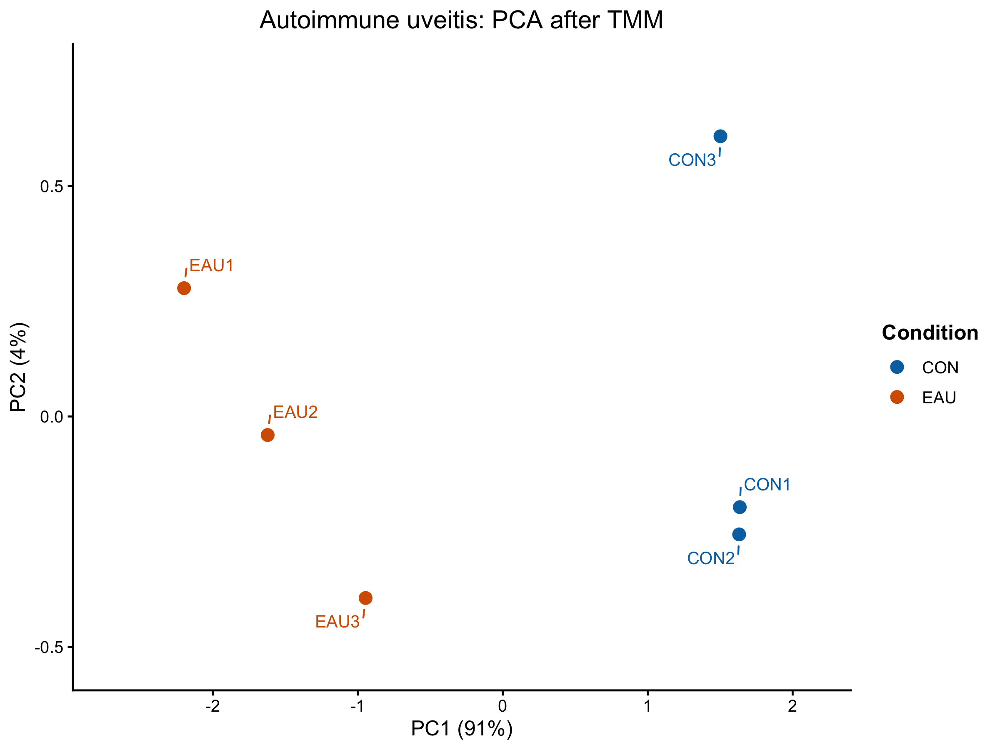

# Spaceflight retina and terrestrial disease responses

**Status: five prechecks completed — glaucoma, retinitis pigmentosa, LHON-linked model, diabetic retinopathy and autoimmune uveitis.**

Maintained by [Kylle Dennice Saligumba](https://github.com/kylledennicesaligumba).

Last documented update: 2 November 2026.

This bioinformatics project asks: **which selected terrestrial eye-disease models most closely resemble the measured mouse retinal response to spaceflight, and which biological programs are shared or change in opposite directions?**

The fixed spaceflight reference is [NASA OSD-758](https://osdr.nasa.gov/bio/repo/data/studies/OSD-758), associated with [Kremsky et al. (2024)](https://doi.org/10.3390/ijms252212041). The planned primary comparison is flight 0 g versus habitat ground controls. The study collected tissue after the mice returned to Earth, so this contrast represents a flight-associated response with recovery exposures included.

Spaceflight-associated neuro-ocular syndrome (SANS) motivates the research. The measurements are from mouse retina; conclusions will concern resemblance among the tested models. A closest model has not yet been established in this workflow.

## Current work

Five processed-data prechecks are completed. Each includes input integrity, sample/feature annotation alignment, expression-distribution checks and reviewed MDS/PCA figures. The RNA-seq workflows use count filtering and TMM. **DR is a deposited processed microarray matrix: no additional log2 transformation, CPM calculation or TMM normalization was performed, and no RNA-seq count-filtering step was applied.**

| Dataset | Completed | Samples used for QC | Feature rows used for QC | Record |
| --- | --- | --- | --- | --- |
| Experimental glaucoma, GSE241782 | 28 October 2026 | All eight selected retinal libraries | 23,301 of 55,487 | [Glaucoma report](docs/glaucoma-precheck.md) |
| Retinitis pigmentosa, GSE156533 | 29 October 2026 | All seven libraries: four P23H and three WT | 17,351 of 54,532 | [RP report](docs/retinitis-pigmentosa-precheck.md) |
| LHON-linked model, GSE304707 | 30 October 2026 | All 12 libraries: three per genotype | 17,860 of 49,714 | [LHON report](docs/lhon-precheck.md) |
| Diabetic retinopathy, GSE87433 | 31 October 2026 | All 17 arrays: six normal, six diabetic, five treated | All 24,973 supplied features | [DR report](docs/diabetic-retinopathy-precheck.md) |
| Experimental autoimmune uveitis, GSE284505 | 2 November 2026 | Six selected samples: three CON and three EAU; sleep-deprivation groups excluded by design | 18,187 of 56,859 | [Uveitis report](docs/autoimmune-uveitis-precheck.md) |

The glaucoma decision retains R-08 with its distinct profile documented and omits the optional correlation check. Glaucoma stages and sex remain recorded; each condition/time pair consists of one male pool and one female pool. The RP decision retains all seven libraries and preserves sex for later genotype modelling. The RP report includes the recorded checkpoint audit and stored TMM-factor table. LHON retains all 12 libraries across WT, YARS2, COI and YARS2/COI, with its final metadata, scaling factors, session record and restore verification documented.

DR retains all 17 arrays for exploratory QC, with the six-versus-six untreated disease contrast and five treated arrays kept conceptually separate. Its native Entrez IDs were aligned with supplied platform gene symbols/names. The boxplot and density plots were reviewed as correct; the author verified all 17 density curves against their corresponding sample columns.

Autoimmune uveitis retains all six selected CON/EAU samples. Original labels mix gene names and Ensembl IDs. After BioMart connections failed, Ensembl REST returned 1,440 names, 24 records without names and 84 unresolved IDs from the 1,548-ID subset. Original labels and lookup gaps are preserved in a separate annotation table; the 55,311 other labels were not queried. Both sleep-deprivation groups remain outside this comparison.

These prechecks concern deposited expression measurements and metadata. Raw sequence or CEL processing was not repeated, and disease–spaceflight similarity has not yet been calculated. The seven-dataset panel remains the agreed project scope.

## Latest completed precheck: autoimmune uveitis

The uveitis PCA uses one common set of 500 variable genes from filtered, TMM-adjusted log-CPM. CON and EAU separate on the first axis; CON3 differs along the second. All six selected samples remain retained. This descriptive view does not establish differential expression or resemblance to spaceflight.

The [uveitis report](docs/autoimmune-uveitis-precheck.md) includes all four figures, sample selection, annotation outcomes and the recorded endpoint. Earlier completed records remain available for [DR](docs/diabetic-retinopathy-precheck.md), [LHON](docs/lhon-precheck.md), [RP](docs/retinitis-pigmentosa-precheck.md) and [glaucoma](docs/glaucoma-precheck.md).

## Explore the repository

- [Glaucoma script](scripts/01_Glaucoma_GSE241782_precheck.R) and [execution guide](docs/running-the-precheck.md).
- [RP script](scripts/02_Retinitis_Pigmentosa_GSE156533_precheck.R), [recovery helper](scripts/03_Retinitis_Pigmentosa_GSE156533_reload.R) and [execution guide](docs/running-the-rp-precheck.md).
- [Shared projection-styling script](scripts/04_Restyle_Retinal_MDS_PCA.R) and [style/reuse instructions](docs/projection-styling.md).
- [Glaucoma metadata](metadata/GSE241782_samples_all.csv) and [RP metadata](metadata/GSE156533_samples_matched.csv), both derived from public source records.
- [LHON teaching script](scripts/05_LHON_GSE304707_precheck.R), [reload helper](scripts/06_LHON_GSE304707_reload.R), [style helper](scripts/07_LHON_projection_style.R), [save/export helper](scripts/08_LHON_GSE304707_save_final.R) and [execution guide](docs/running-the-lhon-precheck.md).
- [LHON matched metadata](metadata/GSE304707_samples_matched.csv), [saved TMM factors](tables/lhon/LHON_GSE304707_TMM_summary_2026-10-30.csv) and [session record](docs/lhon-sessionInfo_2026-10-30.txt).
- [DR teaching script](scripts/09_Diabetic_Retinopathy_precheck.R), [resume helper](scripts/10_Diabetic_Retinopathy_GSE87433_resume.R), [style helper](scripts/11_DR_projection_style.R) and [execution guide](docs/running-the-dr-precheck.md).
- [Uveitis teaching script](scripts/12_Autoimmune_Uveitis_GSE284505_precheck.R), [reload helper](scripts/13_Autoimmune_Uveitis_GSE284505_reload.R), [style helper](scripts/14_Uveitis_projection_style.R), [save/export helper](scripts/15_Autoimmune_Uveitis_GSE284505_save.R) and [execution guide](docs/running-the-uveitis-precheck.md).
- [Uveitis selected metadata](metadata/GSE284505_samples_selected.csv), [gene annotation](tables/autoimmune_uveitis/Autoimmune_Uveitis_GSE284505_gene_annotation_2026-11-02.csv), [TMM summary](tables/autoimmune_uveitis/Autoimmune_Uveitis_GSE284505_TMM_summary_2026-11-02.csv) and [session record](docs/uveitis-sessionInfo_2026-11-02.txt).
- [Dataset panel and input sources](docs/datasets.md).
- [GitHub first steps](docs/github-first-steps.md).

## Planned comparison

Each study will be assessed against its own controls using a method appropriate to its measurement format. The resulting responses will then be compared against the same spaceflight reference. The objective includes relative resemblance, shared programs and opposing responses; no condition is assumed to be the closest in advance.

The panel contains RNA-seq counts and microarray measurements. Exact statistical models and similarity metrics remain to be finalized after the individual prechecks. Separate studies' raw measurements will not be pooled into one disease/control analysis.

## Reproducibility and scope

The precheck scripts are designed for interactive execution one block at a time. Recorded numerical observations and figures come from the author's interactive R runs. Repository synchronization reviewed those records, checked R syntax and preserved the original figure files without rerunning expression analysis. See [environment details](docs/environment.md).

Original expression inputs remain at their public repositories and on local storage; [data instructions](data/README.md) explain where to obtain them. Downloaded expression inputs, R workspace checkpoints and local files under `results/` are excluded from Git. Selected reviewed QC figures are versioned under `figures/`. This repository contains a portable copy of the working script; changes to a separate working copy need to be brought into this repository deliberately.
