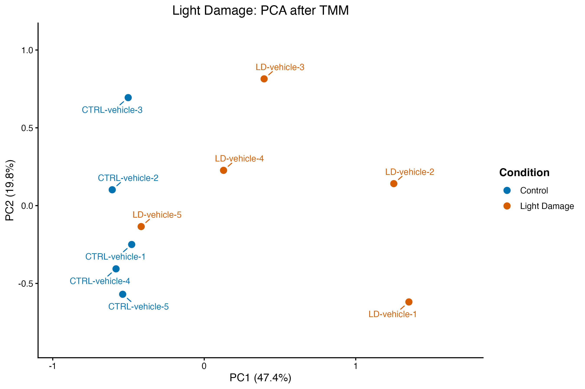

# Spaceflight retina and terrestrial disease responses

**Status: the exploratory comparison of 12 terrestrial contrasts with OSD-758 is complete.**

Maintained by [Kylle Dennice Saligumba](https://github.com/kylledennicesaligumba).

Last documented update: 7 November 2026.

This bioinformatics project asks: **which selected terrestrial eye-disease models most closely resemble the measured mouse retinal response to spaceflight, and which biological programs are shared or change in opposite directions?**

The fixed spaceflight reference is [NASA OSD-758](https://osdr.nasa.gov/bio/repo/data/studies/OSD-758), associated with [Kremsky et al. (2024)](https://doi.org/10.3390/ijms252212041). The reference contrast is flight 0 g versus habitat ground controls. The study collected tissue after the mice returned to Earth, so this contrast represents a flight-associated response with recovery exposures included.

Spaceflight-associated neuro-ocular syndrome (SANS) motivates the research. The measurements are from mouse retina, and the analysis estimates resemblance among the tested models.

## Completed comparison

Two-week experimental glaucoma had the highest observed correlation with the flight response across the shared gene scores (Spearman ρ = 0.243) and Reactome pathway profiles (ρ = 0.302). It ranked first in 545 of 552 pathway neighborhood deletions and second in the other seven. These ranges describe sensitivity to pathway selection. Biological sampling uncertainty remains open. [Final analysis and saved outputs](docs/main_analysis/README.md)

## Within-study differential expression

The [within-study results](docs/withinstudy/README.md) now include study-specific models, complete tested-gene tables, FDR-qualified gene lists, full signed rankings and saved result figures. Glaucoma and RP account for sex; LHON retains three genotype-versus-WT contrasts; DR uses the untreated six-versus-six comparison; AMD has two age-matched gene-level contrasts; uveitis and light damage retain their selected disease/injury comparisons.

RNA-seq models reuse the filtered counts and TMM factors with robust edgeR quasi-likelihood testing. The microarrays use robust limma-trend models. AMD's original array features are mapped conservatively to 19,825 recorded Entrez IDs using fixed maximum-mean representatives, with saved mapping/selection audits. The earlier feature-level results remain identifiable as history. Gene-level FDR calls use BH < 0.05, without an extra fold-change threshold; all tested rows remain in the rankings.

The [overview of 12 contrasts](docs/withinstudy/README.md#recorded-comparison-results) links each dataset's results and figures. The final comparison uses harmonized ranks and pathway profiles. The [OSD-758 result](docs/withinstudy/osdr758.md) supplies the flight reference. [Execution instructions](docs/withinstudy/running-the-analysis.md) describe the required local checkpoints; RP's final checkpoint/session export was not present, while its completed tables, rankings and figures are included.

## Completed prechecks

All seven processed-data prechecks are completed. Each includes input integrity, sample/feature annotation alignment, expression-distribution checks and reviewed MDS/PCA figures. RNA-seq workflows use count filtering and TMM. The microarrays follow distinct branches: **DR uses supplied processed values without additional log2, CPM or TMM; AMD uses a single log2 QC copy of supplied intensities, with no CPM, TMM, extra normalization or expression-row filtering.**

| Dataset | Completed | Samples used for QC | Feature rows used for QC | Record |
| --- | --- | --- | --- | --- |
| Experimental glaucoma, GSE241782 | 28 October 2026 | All eight selected retinal libraries | 23,301 of 55,487 | [Glaucoma report](docs/glaucoma-precheck.md) |
| Retinitis pigmentosa, GSE156533 | 29 October 2026 | All seven libraries: four P23H and three WT | 17,351 of 54,532 | [RP report](docs/retinitis-pigmentosa-precheck.md) |
| LHON-linked model, GSE304707 | 30 October 2026 | All 12 libraries: three per genotype | 17,860 of 49,714 | [LHON report](docs/lhon-precheck.md) |
| Diabetic retinopathy, GSE87433 | 31 October 2026 | All 17 arrays: six normal, six diabetic, five treated | All 24,973 supplied features | [DR report](docs/diabetic-retinopathy-precheck.md) |
| Experimental autoimmune uveitis, GSE284505 | 2 November 2026 | Six selected samples: three CON and three EAU; sleep-deprivation groups excluded by design | 18,187 of 56,859 | [Uveitis report](docs/autoimmune-uveitis-precheck.md) |
| AMD-related CFH-deficiency model, GSE38671 | 3 November 2026 | 16 neuroretina arrays: four per young/aged WT/Cfh-/- group | All 35,556 array features | [AMD report](docs/amd-precheck.md) |
| Light-induced retinal damage, GSE314043 | 3 November 2026 | All 10 libraries: five CTRL-vehicle and five LD-vehicle | 16,852 of 19,999 | [Light-damage report](docs/light-damage-precheck.md) |

The glaucoma decision retains R-08 with its distinct profile documented and omits the optional correlation check. Glaucoma stages and sex remain recorded; each condition/time pair consists of one male pool and one female pool. The RP decision retains all seven libraries and its later genotype model accounts for sex. The RP precheck report includes the recorded checkpoint audit and stored TMM-factor table. LHON retains all 12 libraries across WT, YARS2, COI and YARS2/COI, with its precheck metadata, scaling factors, session record and restore verification documented.

DR retains all 17 arrays for exploratory QC, with the six-versus-six untreated disease contrast and five treated arrays kept conceptually separate. Its native Entrez IDs were aligned with supplied platform gene symbols/names. The boxplot and density plots were reviewed as correct; the author verified all 17 density curves against their corresponding sample columns.

Autoimmune uveitis retains all six selected CON/EAU samples. Original labels mix gene names and Ensembl IDs. After BioMart connections failed, Ensembl REST returned 1,440 names, 24 records without names and 84 unresolved IDs from the 1,548-ID subset. Original labels and lookup gaps are preserved in a separate annotation table; the 55,311 other labels were not queried. Both sleep-deprivation groups remain outside this comparison.

AMD preserves array feature/transcript-cluster IDs and their multiple supplied gene assignments; its expanded annotation is separate from expression measurements. All 16 arrays remain included, with GSM947360 flagged for later inclusion review. Light damage preserves Ensembl IDs, uses a fixed release-116 GTF after REST failures, and retains all 10 libraries, including the control-like LD-vehicle-5. See the [dataset distinctions](docs/datasets.md#measurement-and-identifier-distinctions).

All seven datasets now have group-coloured boxplots. The [shared restyle script and record](docs/boxplot-styling.md) cover the six revised plots; light damage already used this style. Sample keys preserve original IDs and plot order.

These prechecks use deposited expression measurements and metadata for the seven terrestrial datasets. The separate flight precheck records 17 selected libraries. [OSD-758 precheck](docs/osdr758/README.md)

## AMD and light damage prechecks

The [AMD report](docs/amd-precheck.md) documents neuroretina-only selection, the log2 microarray branch, probe-group IDs, ambiguous/truncated annotations and the recorded sample flag. The [light-damage report](docs/light-damage-precheck.md) records count normalization, fixed GTF annotation, all 10 retained libraries and existing independent verification.

Light-damage projections show partial condition separation and variation among LD libraries; LD-vehicle-5 is near controls and remains retained. These findings do not establish differential expression or resemblance to spaceflight. Earlier records remain available for [uveitis](docs/autoimmune-uveitis-precheck.md), [DR](docs/diabetic-retinopathy-precheck.md), [LHON](docs/lhon-precheck.md), [RP](docs/retinitis-pigmentosa-precheck.md) and [glaucoma](docs/glaucoma-precheck.md).

## Explore the repository

- [Final comparison scripts](scripts/main_analysis/), [tables](tables/main_analysis/) and [figures](figures/main_analysis/).
- [Earlier analysis scripts and dated backups](scripts/archive/).
- [Within-study results and 12-comparison summary](docs/withinstudy/README.md), [analysis scripts](scripts/withinstudy/), [result tables](tables/withinstudy/) and [figures](figures/withinstudy/).
- [Glaucoma script](scripts/01_Glaucoma_GSE241782_precheck.R) and [execution guide](docs/running-the-precheck.md).
- [RP script](scripts/02_Retinitis_Pigmentosa_GSE156533_precheck.R), [recovery helper](scripts/03_Retinitis_Pigmentosa_GSE156533_reload.R) and [execution guide](docs/running-the-rp-precheck.md).
- [Shared projection-styling script](scripts/04_Restyle_Retinal_MDS_PCA.R) and [style/reuse instructions](docs/projection-styling.md).
- [Glaucoma metadata](metadata/GSE241782_samples_all.csv) and [RP metadata](metadata/GSE156533_samples_matched.csv), both derived from public source records.
- [LHON teaching script](scripts/05_LHON_GSE304707_precheck.R), [reload helper](scripts/06_LHON_GSE304707_reload.R), [style helper](scripts/07_LHON_projection_style.R), [save/export helper](scripts/08_LHON_GSE304707_save_final.R) and [execution guide](docs/running-the-lhon-precheck.md).
- [LHON matched metadata](metadata/GSE304707_samples_matched.csv), [saved TMM factors](tables/lhon/LHON_GSE304707_TMM_summary_2026-10-30.csv) and [session record](docs/lhon-sessionInfo_2026-10-30.txt).
- [DR teaching script](scripts/09_Diabetic_Retinopathy_precheck.R), [resume helper](scripts/10_Diabetic_Retinopathy_GSE87433_resume.R), [style helper](scripts/11_DR_projection_style.R) and [execution guide](docs/running-the-dr-precheck.md).
- [Uveitis teaching script](scripts/12_Autoimmune_Uveitis_GSE284505_precheck.R), [reload helper](scripts/13_Autoimmune_Uveitis_GSE284505_reload.R), [style helper](scripts/14_Uveitis_projection_style.R), [save/export helper](scripts/15_Autoimmune_Uveitis_GSE284505_save.R) and [execution guide](docs/running-the-uveitis-precheck.md).
- [Uveitis selected metadata](metadata/GSE284505_samples_selected.csv), [gene annotation](tables/autoimmune_uveitis/Autoimmune_Uveitis_GSE284505_gene_annotation_2026-11-02.csv), [TMM summary](tables/autoimmune_uveitis/Autoimmune_Uveitis_GSE284505_TMM_summary_2026-11-02.csv) and [session record](docs/uveitis-sessionInfo_2026-11-02.txt).
- [AMD teaching script](scripts/16_AMD_GSE38671_precheck.R), [reload](scripts/17_AMD_GSE38671_reload.R), [annotation formatter](scripts/18_AMD_annotation_format.R), [projection helper](scripts/19_AMD_projection_style.R), [save helper](scripts/24_AMD_save_session.R) and [execution guide](docs/running-the-amd-precheck.md).
- [Light-damage script](scripts/20_Light_Damage_GSE314043_precheck.R), [reload](scripts/21_Light_Damage_GSE314043_reload.R), [verification](scripts/22_Light_Damage_GSE314043_verify.R), [saved result tables](tables/light_damage/) and [execution guide](docs/running-the-light-damage-precheck.md).
- [Group-coloured boxplots and sample keys](docs/boxplot-styling.md).
- [Dataset panel, measurement/identifier distinctions and input sources](docs/datasets.md).
- [GitHub first steps](docs/github-first-steps.md).

## Reproducibility and scope

The teaching scripts are designed for interactive execution one block at a time; separate complete workflows and restore helpers are documented where provided. Recorded observations and figures come from the completed project R runs. Repository synchronization reviewed those records, checked script syntax/portable paths and saved-table consistency, and preserved the original figure files without rerunning expression analysis. See [environment details](docs/environment.md).

Original expression inputs remain at their public repositories and on local storage; [data instructions](data/README.md) explain where to obtain them. Downloaded expression inputs, R workspace checkpoints and local files under `results/` are excluded from Git. Selected reviewed QC figures are versioned under `figures/`. The repository includes portable copies of the current scripts and an archive of earlier scripts.
