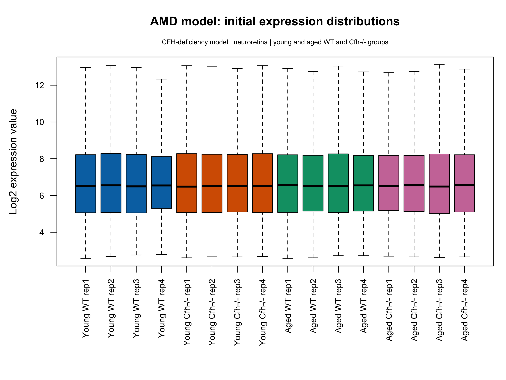
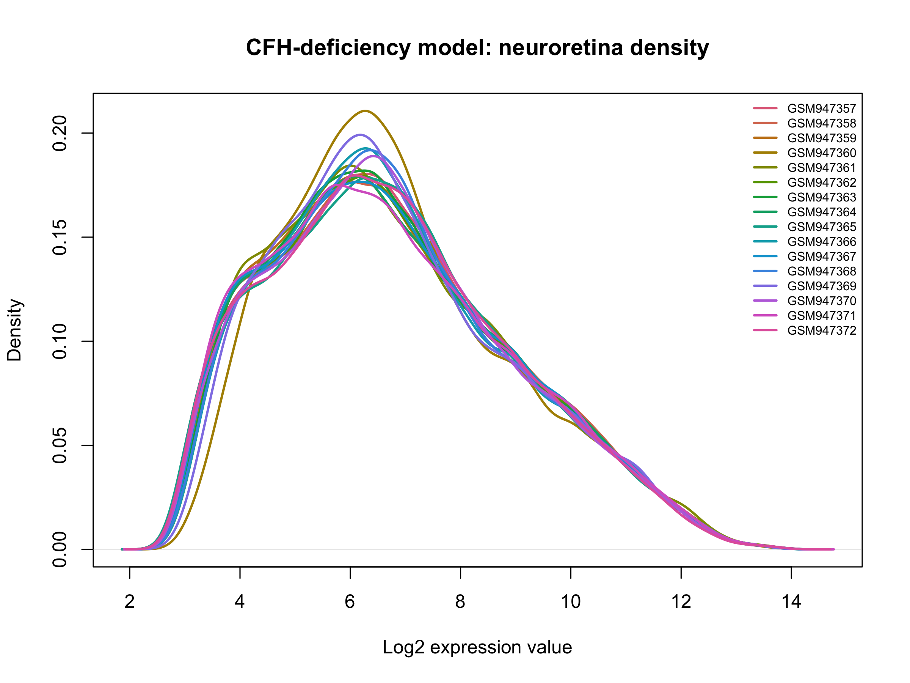
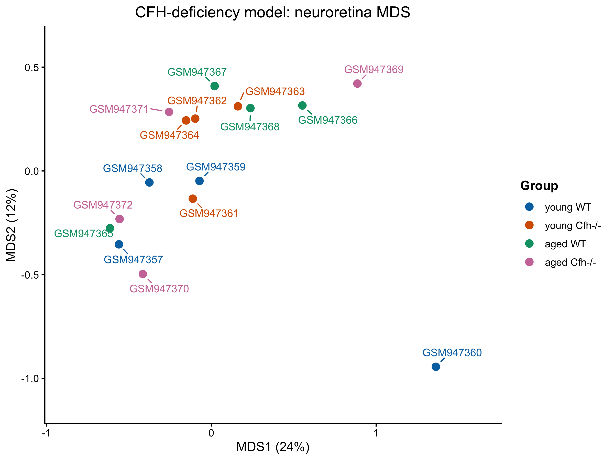
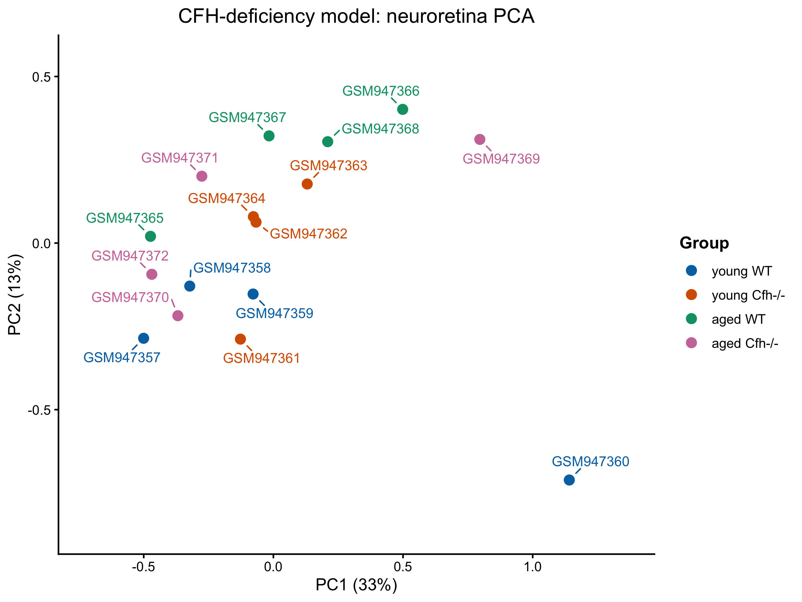

# AMD-related CFH-deficiency model GSE38671: completed precheck

**Completed:** 3 November 2026. **Current selection:** retain all 16 neuroretina arrays, four in each young/aged WT/Cfh-/- group. Preserve the separate age-matched genotype comparisons. RPE/choroid arrays are excluded by tissue selection, not because they failed QC.

## Measurement and scale

[GSE38671](https://www.ncbi.nlm.nih.gov/geo/query/acc.cgi?acc=GSE38671) is an AMD-related complement-factor-H deficiency model, measured using the GPL6246 Affymetrix Mouse Gene 1.0 ST microarray platform. It is not an RNA-seq count dataset or human AMD patient cohort.

The deposited table has 35,556 feature rows and 32 arrays: 16 neuroretina and 16 RPE/choroid. All original arrays remain in the imported objects. Metadata matching and the 16-array neuroretina selection were confirmed in exact expression-column order. Each selected age/genotype combination has four labelled arrays, recorded as mouse/C57BL/6J. Sex, exact numerical ages and independent-animal/pooling provenance were not established in the reviewed fields.

The supplied values are continuous intensities. All values were numeric and finite, with no missing entries or missing/blank/repeated feature IDs. The full-table range was 5.8–16,719.9. Selected quantiles were 6, 34.5, 92.1, 298.2, 4,315.91 and 16,719.9 at 0%, 25%, 50%, 75%, 99% and 100%. The completed workflow used **one log2 transformation into a separate QC copy**, preserving the supplied matrix. That copy is 35,556 × 16, finite throughout, with range 2.584963–14.029279.

**No CPM calculation, TMM normalization, additional microarray normalization or expression-row filtering was performed.** All 35,556 features remain available for exploratory feature selection. This differs from DR, whose supplied processed values were used without an additional log2 transformation. Transformation decisions follow the supplied scale, not the word “microarray” alone. The reviewed first-sample processing field reports Expression Console 1.1; that text alone does not establish every prior preprocessing step.

## Array IDs and multipart gene annotation

The numeric `ID_REF` values are **array feature/transcript-cluster IDs**, rather than Entrez gene IDs. A transcript cluster summarizes a group of physical probes to one expression value per sample. Annotation can link that feature to several reference transcripts and gene symbols; those annotation rows are not separate expression measurements. The [official Affymetrix Bioconductor workflow](https://bioconductor.org/packages/devel/workflows/vignettes/maEndToEnd/inst/doc/MA-Workflow.html#old-and-new-probesets-of-affymetrix-microarrays) explains Gene ST summarization and multiple mappings.

| Reviewed annotation check | Result |
| --- | --- |
| Expression-row IDs | 35,556 digits-only IDs, matching original `ID_REF` order |
| Original GPL6246 table | 35,557 rows × 12 supplied fields; no missing/blank or duplicate IDs |
| Platform coverage | Every expression ID has a platform record |
| Extra platform record | `10338063` is absent from the expression matrix; reason not established |
| Matched feature annotation | 35,556 × 12, in exact expression-row order |
| Separate readable assignment table | 298,709 rows × 12; all original platform records represented |

The formatter separates `///` assignment records and their `//` fields while preserving original strings and indices. The resulting columns include reference ID, gene symbol, description, cytoband and Entrez ID. It retains unassigned features and multiple assignments without selecting one automatically. For example, feature `10344614` has supplied assignments to Gm16088, Gm14300, G430049J08Rik and Gm2889. These are candidate annotations of one measured feature.

Feature `10412503` contains the source marker `[WARNING: THIS FIELD TRUNCATED]`. The known incomplete assignment retains `ENSMUST00000178728` and Gm10340; missing subsequent fields remain unavailable. Feature-level and assignment-level truncation flags preserve this limitation. Missing text is not reconstructed.

The expression matrix was not expanded, collapsed by symbol or filtered by annotation availability. A later gene-level comparison with spaceflight will need an explicit mapping policy; this precheck does not resolve ambiguous features into independent gene-specific responses. The 1.82 GB full formatted annotation, 26.45 MB viewing copy and original platform table remain local; the formatter and public source instructions provide their provenance without adding those large reference files to Git.

## Distribution and projection review

The boxplots have similar medians/spreads, with GSM947360 slightly narrower; its density has a taller central peak. The revised boxplot uses age/genotype colours and readable labels, with the [sample key](../metadata/boxplot_sample_keys/AMD_GSE38671_log2_expression_boxplot_sample_key.csv) preserving each original GSM ID. The [selected metadata](../metadata/GSE38671_samples_selected.csv) was recovered from that existing key in original expression-column order.

MDS uses pairwise top-500 **features**; PCA uses one common set of 500 variable **features** from the log2 QC matrix. Displayed axes are 24%/12% for MDS and 33%/13% for PCA.

The four age/genotype groups partly overlap. Young WT GSM947360 is distinct in both projections; aged WT GSM947365 also differs from its other group members, and aged Cfh-/- arrays are dispersed. The recorded decision retains all 16 while flagging GSM947360 for review before final modelling inclusion. The figures do not establish a technical cause, failed array, differential expression or resemblance to spaceflight. Completion of exploratory prechecks is distinct from a finalized differential-expression design.

## Saved state and upload scope

The dated `AMD_GSE38671_precheck_checkpoint_2026-11-02.RData` exists locally (6,052,222 bytes). The shared restyle script explicitly treats it as predating the later plots, reconstructing only the already agreed neuroretina selection and log2 copy for the boxplot. Its presence is not a claim that this checkpoint contains the complete 3 November state. The latest main script ends by loading a timestamped save helper. That helper creates a new script copy/checkpoint, session record and optional console history, then updates a latest-checkpoint pointer. It has been prepared but no new timestamped checkpoint was confirmed during synchronization. The reload helper follows the pointer when present and otherwise uses the older 2 November fallback. No binary was loaded or updated, and no completed-state restore claim is made.

The repository contains [main](../scripts/16_AMD_GSE38671_precheck.R), [reload](../scripts/17_AMD_GSE38671_reload.R), [annotation formatter](../scripts/18_AMD_annotation_format.R) and [projection helper](../scripts/19_AMD_projection_style.R) copies, a [timestamped save helper](../scripts/24_AMD_save_session.R), plus four original figures. See the [execution guide](running-the-amd-precheck.md) and [boxplot update](boxplot-styling.md).

This report consolidates the completed interactive record and saved outputs. Upload preparation checked syntax, portable paths, sample keys and figure identity without importing expression inputs, reading the large platform table, loading binary workspaces, rerunning QC or generating new scientific figures. Original external-drive files are preserved. No differential-expression, pathway or disease–spaceflight analysis was performed for this upload.
