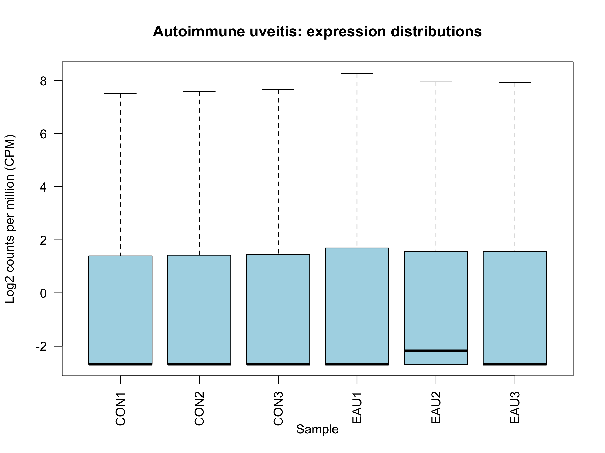
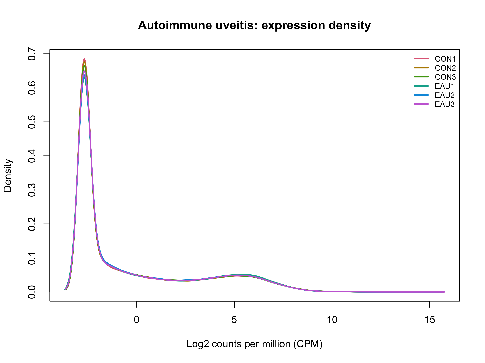
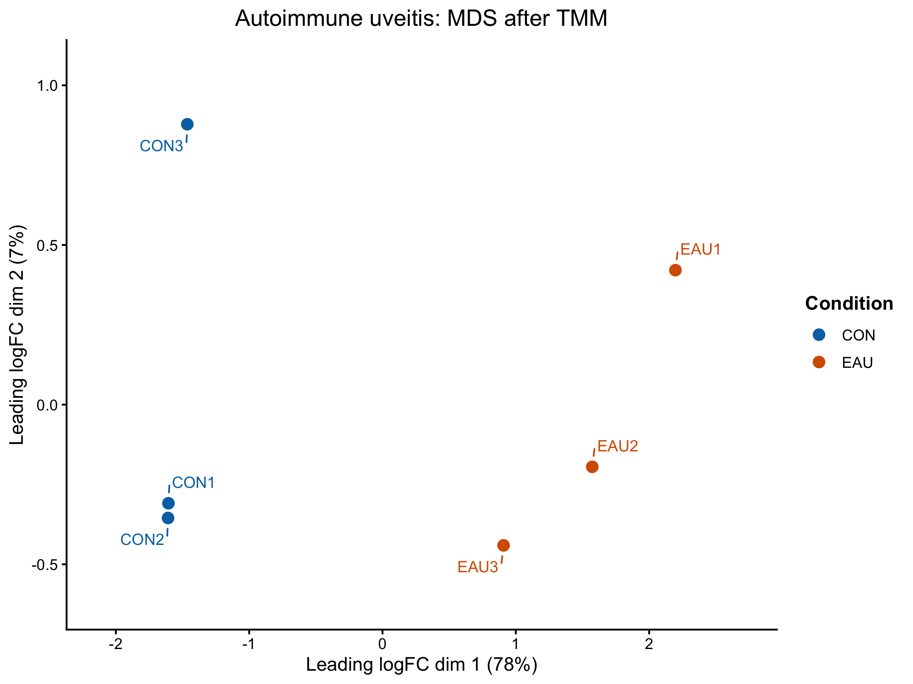
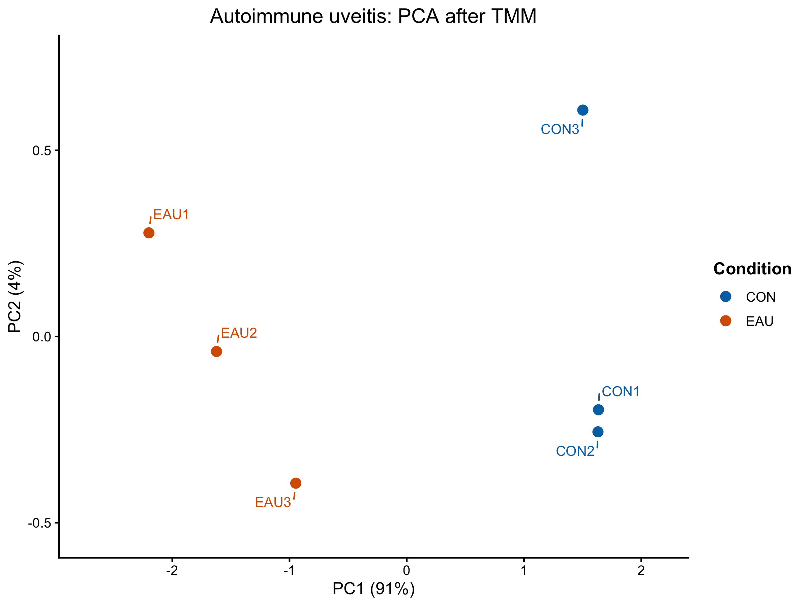

# Experimental autoimmune uveitis GSE284505: completed processed-data precheck

**Completed:** 2 November 2026.

**Decision:** Retain the six selected retinal samples: three healthy controls (CON) and three experimental autoimmune uveitis samples (EAU). Exclude both sleep-deprivation groups from this disease comparison by design. The filtered QC copy contains 18,187 gene rows. No selected sample was excluded as a failed library.

## Inputs and selected comparison

The source is [GSE284505](https://www.ncbi.nlm.nih.gov/geo/query/acc.cgi?acc=GSE284505). The deposited HTSeq count table is locally named `GSE284505_R.HTSeq.counts.txt`; the local metadata archive `GSE284505_family` contains `GSE284505_family.xml`.

The original matrix contains 56,859 rows and 12 sample columns: CON, EAU, CSD-CON and CSD-EAU, with three labelled samples each. CSD denotes chronic sleep deprivation. The selected comparison is **EAU versus CON**, keeping the disease response separate from the sleep-deprivation intervention. The six CSD samples are excluded from the selected matrix, not deleted from the original input or full-count objects. This is a study-design choice, not a quality-failure finding.

The [saved selected metadata](../metadata/GSE284505_samples_selected.csv) follows count-column order: CON1–CON3, then EAU1–EAU3. All are labelled Retina. The field called `genotype` in the source metadata contains condition codes; it should not be interpreted as proof of distinct genetic backgrounds. EAU titles describe IRBP peptide and CFA for two weeks. Sex, exact tissue-collection timing and independent-animal/pooling provenance were not established in the jointly inspected fields; full-paper methods verification remains a later design-documentation task.

## Completed checks

| Component | Recorded result |
| --- | --- |
| Original input | 56,859 rows, one `AccID` field and 12 sample columns |
| Integrity | No missing entries, blank/missing or repeated gene labels; counts numeric, finite, nonnegative and whole-valued; range 0–616,271 |
| Metadata matching | Twelve metadata rows matched uniquely and in exact count-column order |
| Selected comparison | 56,859 × 6 counts; six metadata rows, three CON and three EAU; exact alignment confirmed |
| Initial distributions | All-row log-CPM boxplot and density reviewed before filtering/TMM; broad overlap; retain all six |
| Gene annotation | Original mixed labels preserved; separate 56,859 × 9 annotation table aligned to count rows |
| Expression filtering | `filterByExpr` retained 18,187 rows and excluded 38,672 from the QC copy |
| TMM | Positive, finite factors approximately 0.9857–1.0341 |
| Normalized exploration | Finite 18,187 × 6 TMM-adjusted log-CPM matrix with sample order preserved |
| MDS | Pair-specific top 500 genes; displayed axes 78% and 7% |
| PCA | One common set of 500 variable genes; displayed axes 91% and 4% |

The expression filter uses the familiar RP/LHON settings: `min.count = 10`, `min.total.count = 15` and the selected CON/EAU groups. Filtering is based on expression, not whether an identifier received a gene name. Original count objects and labels are preserved.

## Mixed labels and Ensembl annotation

The supplied `AccID` labels mix symbol-style gene names and Ensembl mouse gene IDs. The reviewed inventory contains **1,548 ENSMUSG-prefixed IDs** and **55,311 other labels**. Those other labels were preserved as supplied; their database membership was not independently validated and they were not sent through this Ensembl-ID lookup.

BioMart connections failed during the 2 November session, so they produced no annotation result. The workflow instead used Ensembl's REST API, requesting ten preview IDs and then the remaining IDs in batches of at most 1,000. This recovered annotation records for 1,464 of the 1,548 requested IDs. The API distinguishes IDs with no returned record; a returned record may also lack a display name. See the [official batch-lookup documentation](https://rest.ensembl.org/documentation/info/lookup_post).

| Saved lookup status | Rows | Meaning |
| --- | ---: | --- |
| `found_with_name` | 1,440 | Ensembl record returned with a gene display name |
| `found_without_name` | 24 | Record returned, but no gene display name supplied |
| `not_found` | 84 | No record returned by this lookup |
| `not_queried` | 55,311 | Original non-ENSMUSG labels, outside this lookup |

For example, `ENSMUSG00000117238` returned `Gm57191`; `ENSMUSG00000118513` returned a pseudogene record without a display name; `ENSMUSG00000120887` returned no record. Missing names remain `NA`, and the original `AccID` is retained for every row. A missing added `gene_name` for a `not_queried` row does not mean the original symbol-style label is absent.

The [dated annotation export](../tables/autoimmune_uveitis/Autoimmune_Uveitis_GSE284505_gene_annotation_2026-11-02.csv) records **Ensembl release 116**, and all 1,464 returned records are mouse (`mus_musculus`), on **GRCm39**. The reviewed original processing notes report **GRCm38** without an annotation release. These are distinct provenance records: this lookup adds names, without realigning data or converting the original genome annotation. No cause was established for each unresolved ID, and the report does not attribute every gap to a version mismatch.

None of the 1,548 exported Ensembl `AccID` values has a dotted version suffix. The export records the database release and assembly, but does not include a per-gene version field. Original identifiers were not stripped, replaced or removed because a name was unavailable. Cross-study identifier harmonization remains a later task. Live API results may change; this dated table preserves the completed run.

## Library summaries

Original totals and positive-count row counts below come from the reviewed session record. Filtered library totals and factors come from the [saved TMM summary](../tables/autoimmune_uveitis/Autoimmune_Uveitis_GSE284505_TMM_summary_2026-11-02.csv), without recalculation.

| Sample | Original total counts | Rows with positive counts | Filtered library total | TMM factor |
| --- | ---: | ---: | ---: | ---: |
| CON1 | 11,745,016 | 27,183 | 11,713,766 | 0.9951094415 |
| CON2 | 11,886,132 | 27,304 | 11,853,644 | 0.9997540506 |
| CON3 | 12,810,010 | 27,761 | 12,773,081 | 0.9892151064 |
| EAU1 | 12,014,718 | 27,643 | 11,975,354 | 1.0340989270 |
| EAU2 | 14,955,036 | 28,509 | 14,909,618 | 0.9857362580 |
| EAU3 | 13,977,998 | 27,877 | 13,938,899 | 0.9968330350 |

TMM factors adjust effective library sizes; they are not sample-quality scores and do not overwrite raw counts.

## Figures and reviewed interpretation

All four figures are unchanged copies of the saved local PNGs, visually inspected during synchronization.

The initial distributions use all 56,859 rows, before filtering and TMM. The prominent low-count density peak and low boxplot medians reflect the large zero/low-count component. EAU2 has just over half of its rows positive, consistent with its median lying above the zero-count floor. Broad distribution overlap does not establish identical gene-specific expression.

Both projections use the filtered TMM-adjusted log-CPM matrix. MDS uses pairwise-selected top genes; PCA uses one common set of 500 variable genes.

CON and EAU separate along the first axis in both views. CON3 differs from CON1/CON2 along the second axis; all six selected samples remain retained. The opposite left/right orientations of the two views carry no biological direction by themselves. Axis percentages summarize each representation; they do not measure the percentage of genes affected by disease or establish differential expression. These figures do not establish resemblance to spaceflight.

## Saved state and scope

The final checkpoint is `Autoimmune_Uveitis_GSE284505_precheck_checkpoint_2026-11-02.RData`. Its presence and the exported tables/session record were confirmed during synchronization. The binary checkpoint was not loaded, its object count was not audited, and a restore test was not performed for this upload. The earlier 31 October checkpoint and pause note describe a partial historical stage, rather than the completed endpoint.

The repository includes the [teaching script](../scripts/12_Autoimmune_Uveitis_GSE284505_precheck.R), [reload helper](../scripts/13_Autoimmune_Uveitis_GSE284505_reload.R), [style helper](../scripts/14_Uveitis_projection_style.R), [save/export helper](../scripts/15_Autoimmune_Uveitis_GSE284505_save.R) and [actual session information](uveitis-sessionInfo_2026-11-02.txt). See the [execution guide](running-the-uveitis-precheck.md).

This precheck concerns deposited counts and metadata. It does not repeat raw sequencing QC/alignment or perform differential-expression, pathway or disease–spaceflight comparison analysis. Synchronization reviewed completed records and exported tables, checked script syntax and portable paths, and preserved original figures. It did not import expression inputs, inspect additional unreviewed metadata, load RData, rerun analysis or make new annotation requests. The original external-drive files are preserved; downloaded inputs and binary checkpoints remain local.
