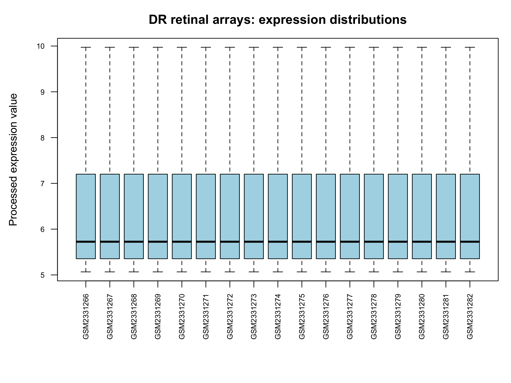
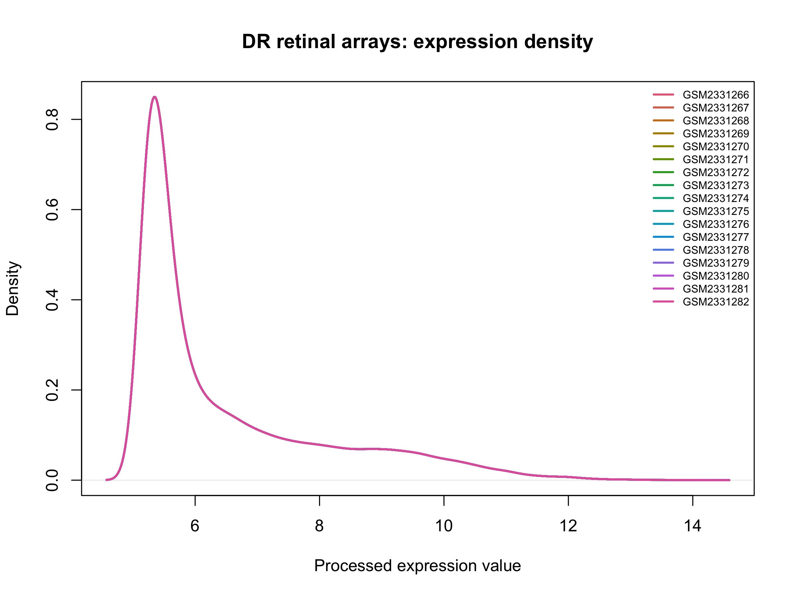
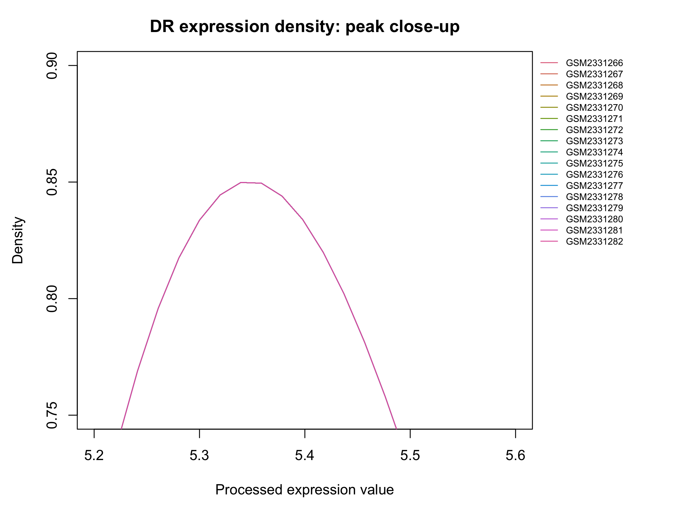
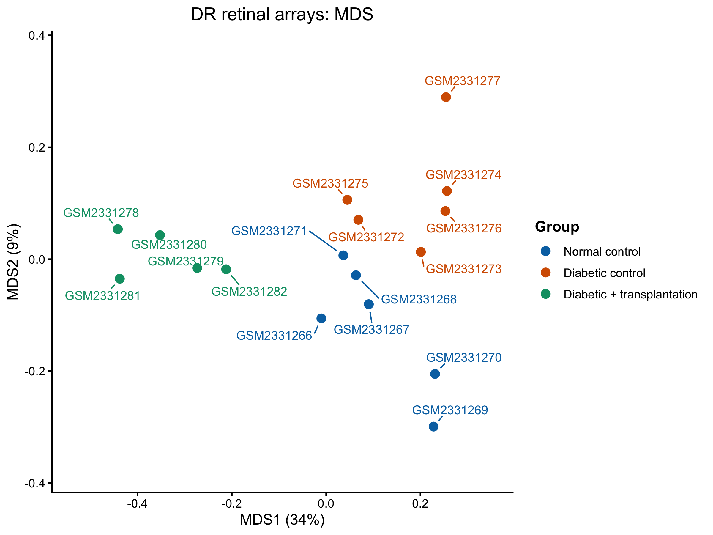
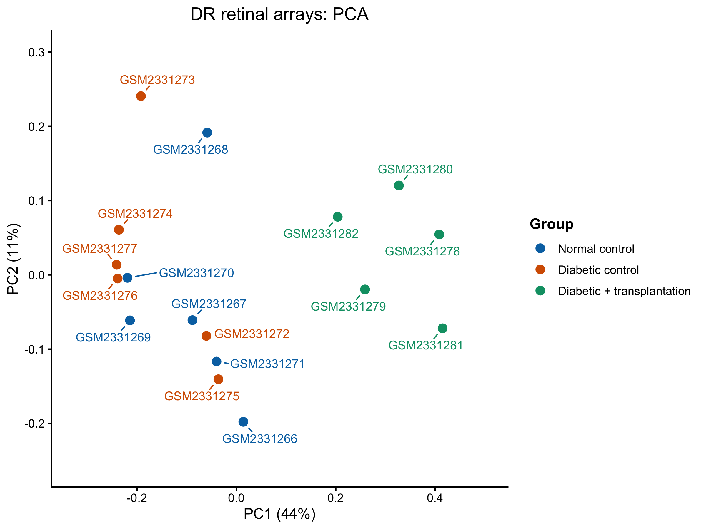

# Diabetic retinopathy GSE87433: completed processed-data precheck

**Completed:** 31 October 2026, as reported by the author after the reviewed MDS/PCA outputs and final checkpoint save.

**Input type: processed microarray expression. No additional log2 transformation, CPM calculation or TMM normalization was performed in this precheck.** The deposited values were used as supplied. This statement concerns the current precheck, rather than claiming that the original study supplied untransformed measurements.

All 17 arrays remain available for QC. No sample or expression row was excluded in this workflow. The planned disease-response comparison is the six untreated diabetic samples versus six normal controls; the five transplantation/insulin-treated samples remain a separate condition. No differential-expression model was fitted.

## Dataset and measurement format

The source is [GSE87433](https://www.ncbi.nlm.nih.gov/geo/query/acc.cgi?acc=GSE87433), a mouse retinal STZ-diabetes study. The reviewed platform is GPL20710, Affymetrix Mouse Gene 2.0 ST Array with the custom `mogene20st_Mm_ENTREZG_19` definition.

| Group | Arrays used for exploratory QC | Role |
| --- | ---: | --- |
| Normal control | 6 | Normoglycemic, without transplantation |
| Diabetic control | 6 | Untreated diabetic comparison |
| Diabetic + transplantation | 5 | Separate treated condition; source descriptions also mention insulin-releasing pellets |

The imported expression table has 24,973 feature rows and 17 GSM sample columns, plus `ID_REF`. Unlike RNA-seq read counts, these are already processed continuous expression values. The source processing text describes JMP Genomics 7, custom Entrez-based CDF v19, RMA background correction, quantile normalization and median-polish summarization. The exact log base was not explicitly established from that reviewed text; plots therefore retain the label **Processed expression value**.

No new log2 transformation, CPM conversion, TMM scaling, RNA-seq `filterByExpr` step or additional normalization was applied. Library read-depth totals and positive-count gene detection were not treated as equivalent microarray QC measures.

## Completed checks

| Component | Recorded result |
| --- | --- |
| Input integrity | No missing entries, missing/blank IDs or duplicated IDs; all 17 expression columns numeric |
| Expression matrix | 24,973 by 17; all values finite; range 5.066406–14.095703 |
| Sample metadata | 17 matched rows; GSM identity and order confirmed identical to matrix columns |
| Platform/organism | Mouse whole retina; GPL20710 mouse-array platform reviewed |
| Expression distributions | Boxplot, density and density close-up confirmed correct and reviewed across all 17 arrays; the close visual overlap is preserved as the observed result |
| Density verification | User-run checks confirmed each of the 17 stored curves matched its own expression column and names/order matched; this was not an equality test between samples |
| Feature IDs | All 24,973 have digits-only format and match original `ID_REF` values in order; format is not external database validation |
| Supplied annotation | Headerless platform table imported with all 24,973 rows; its 15 supplied column names were obtained from XML definitions |
| Annotation alignment | Unique platform IDs matched the expression-row set; aligned annotation is 24,973 by 15, with exact ID order confirmed |
| MDS | Pair-specific top 500 features; displayed axes approximately 34% and 9% |
| PCA | One common set of 500 variable features; displayed axes approximately 44% and 11% |

The expression-row labels are Entrez-based gene IDs. The annotation step uses the deposited platform table, including `ID`, `ENTREZ_GENE_ID`, `Symbol` and `description`. It does not replace identifiers using a current external database or complete cross-study gene harmonization. All 24,973 supplied expression rows remain available for projection feature selection.

## Gene identifiers and names

DR expression rows use **Entrez gene IDs**, while the supplied platform gene-annotation table provides the corresponding symbols/names. For example, the reviewed annotation links ID `11287` to symbol `Pzp`. `ID` is the matching key, `ENTREZ_GENE_ID` records the identifier, `Symbol` gives the short name, and `description` supplies a longer description.

This is gene-level metadata describing expression rows. The separate sample-metadata table describes array columns and their experimental conditions. Both types came from the deposited records; adding names does not change the expression measurements.

The native labels differ across studies: glaucoma combines an Ensembl ID and symbol, RP uses Ensembl IDs with supplied workbook annotations, LHON retains symbol-style names, and DR uses Entrez IDs with platform annotations. This precheck preserved each study's native identifiers. Cross-study gene matching remains a later step; it was not performed by changing the row labels here.

## Saved figures

These five PNGs were copied unchanged from the completed local precheck. Points in MDS/PCA remain at their calculated coordinates; labels are separated with connector lines and outside group legends.

### Processed-expression boxplot

### Density and close-up

The boxplot and both density views were reviewed as correct exports. The author explicitly checked that all 17 density curves were present in the correct sample order and that every stored curve matched a fresh calculation from its own expression column. This confirms the plotted curves were drawn from the corresponding samples, rather than a single curve being assigned to all samples.

The distributions overlap closely, consistent with the recorded prior quantile normalization; the general distribution-alignment property is documented in the [limma manual](https://bioconductor.org/packages/release/bioc/manuals/limma/man/limma.pdf#page=140). Similar distributions do not establish identical gene-specific values or overall sample quality. The close-up changes axis limits only; it does not subset expression features, refit densities or normalize values again.

### MDS

### PCA

The treated group is distinct in both views. Normal-versus-diabetic separation is less prominent: the MDS shows some vertical separation, while the common-feature PCA shows substantial overlap. Opposite left/right orientation between the two plots has no biological meaning. Peripheral positions alone did not justify removing samples.

These are incomplete, two-dimensional summaries with different feature-selection rules. Axis percentages do not quantify a treatment effect, disease severity or the number of changed genes. The combined transplantation/insulin condition cannot be attributed to a single treatment component from these plots. Its separation does not establish recovery, treatment failure or hyperglycaemic memory. Overlap of untreated groups does not establish absence of a disease response.

## Scope and provenance limitations

This precheck starts from the deposited processed matrix. Raw CEL processing was not repeated. Shared protocol prose contains inconsistent age and array-species wording; the reviewed mouse platform, sample conditions and paper context were kept distinct rather than overwriting sample fields. Induction age and sex were found in narrative protocol/paper context, not recorded as newly verified per-array columns. Administrative submission/update dates were not treated as retinal collection or RNA-extraction dates.

The original study is [Friedrichs et al. (2017), Hyperglycaemic memory affects the neurovascular unit of the retina in a diabetic mouse model](https://doi.org/10.1007/s00125-017-4254-y). Its experimental context supports the disease/control distinction, rather than validating this project's complete cross-disease workflow.

No differential-expression tests, pathway findings, disease ranking or comparison against OSD-758 was performed. The six-versus-six disease contrast remains separate from the 17-array exploratory QC view.

## Code and saved state

- [Main teaching script](../scripts/09_Diabetic_Retinopathy_precheck.R).
- [Completed-stage resume helper](../scripts/10_Diabetic_Retinopathy_GSE87433_resume.R).
- [Projection-style/export helper](../scripts/11_DR_projection_style.R).
- [Execution guide](running-the-dr-precheck.md).

The new `DR_GSE87433_precheck_checkpoint_2026-10-31.RData` file was confirmed present during synchronization. Its contents were not loaded or independently restore-verified during this update. The earlier 30 October checkpoint is a partial backup. XML pointers are rebuilt by the resume helper. Both binary workspaces, original expression inputs and the downloaded platform table remain local.

This report consolidates the completed user-run outputs and saved figures. GitHub synchronization inspected the images, parsed scripts without execution, compared source calculations and checked links/file integrity. It did not read the expression matrix, platform table or unreviewed XML, load checkpoints, repeat normalization/projections, or regenerate figures. Original MaxineDrive files were preserved. Earlier pending notes in the source learning log are superseded here only where completed outputs or file presence establish the later state.

## Method documentation

The [limma reference manual](https://bioconductor.org/packages/release/bioc/manuals/limma/man/limma.pdf) documents quantile normalization and the pairwise/common-feature projection modes. The [official ggrepel examples](https://ggrepel.slowkow.com/articles/examples.html) support the label layout. These references support individual components; they do not establish disease–spaceflight resemblance.
