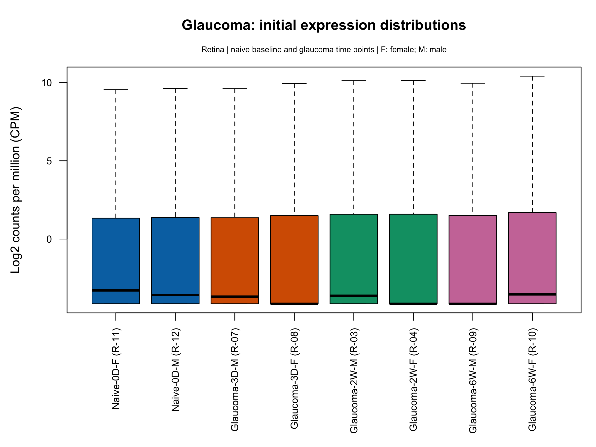
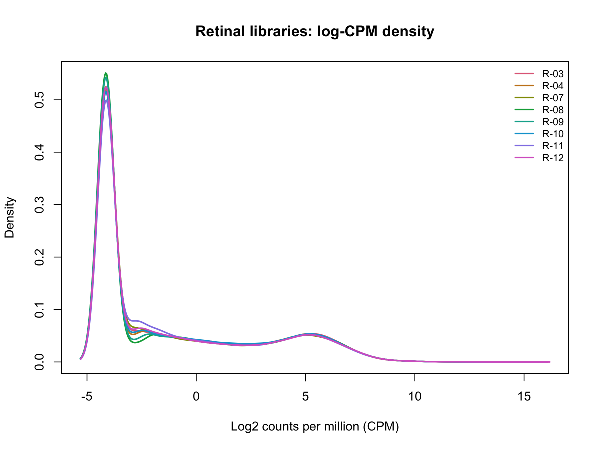
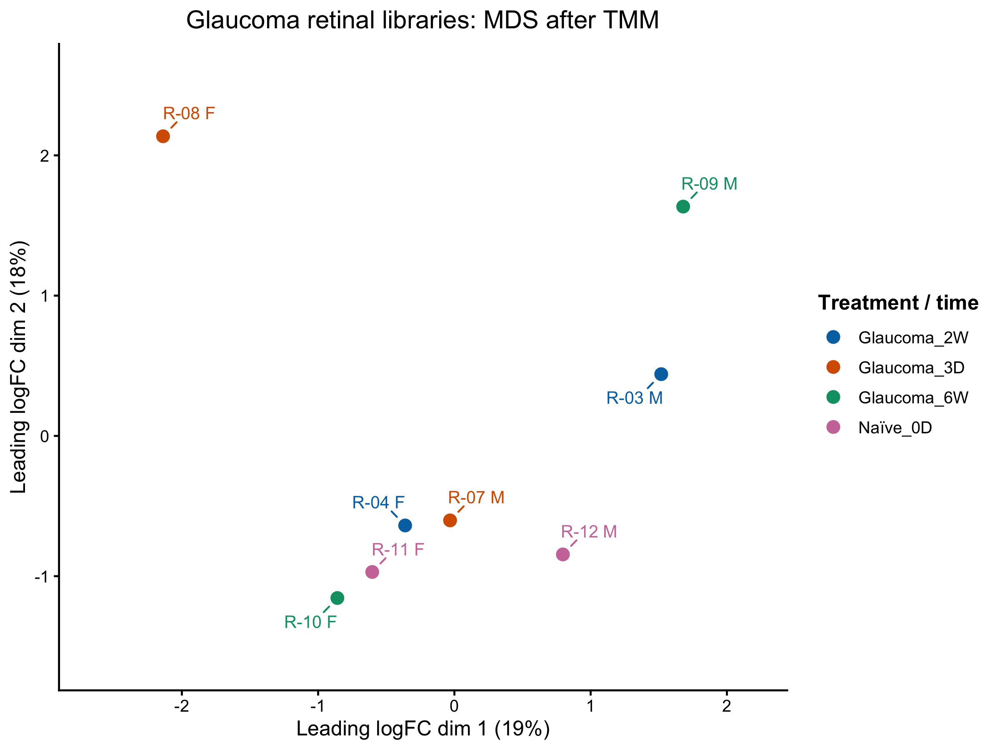
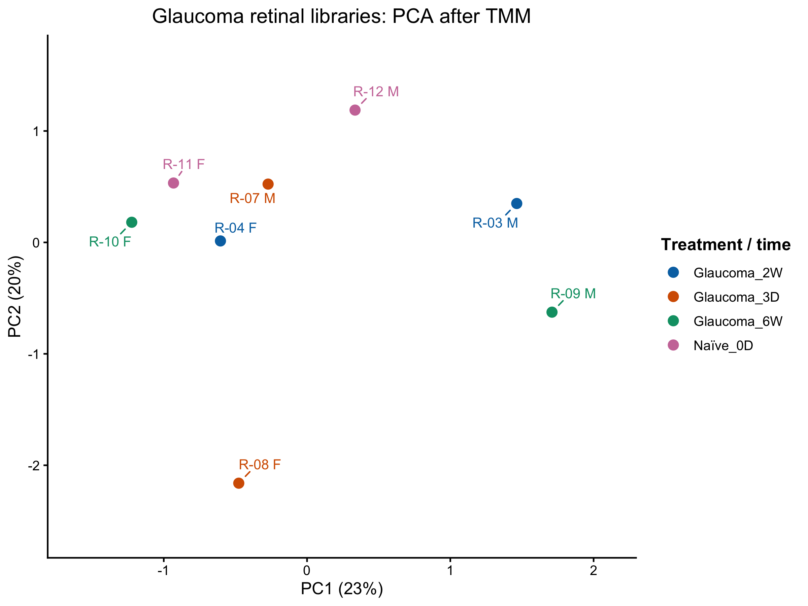

# Glaucoma GSE241782: completed processed-data precheck

**Figure update — 3 November 2026:** the boxplot below now uses group colours and revised sample labels/order. Its [sample key](../metadata/boxplot_sample_keys/Glaucoma_GSE241782_logCPM_boxplot_sample_key.csv) preserves the original IDs. The saved restyle record confirms unchanged per-sample boxplot statistics; other figures and recorded analysis/sample decisions are preserved. See [boxplot styling](boxplot-styling.md).

**Completed:** 28 October 2026, at the agreed endpoint.

**Decision:** Retain all eight selected retinal libraries, including R-08, and proceed to the next dataset. R-08's distinctive profile remains documented; it has not been diagnosed as a failed library. The optional sample-correlation check was not performed, by the author’s decision.

## Inputs and selected comparison

- Dataset folder: `data/raw/Glaucoma_GSE241782`, or the folder set by `GLAUCOMA_DATA_DIR`.
- Counts: `GSE241782_gene_count_matrix.csv`.
- Metadata: `GSE241782_family.soft`.
- Original count matrix: 55,487 gene rows by 36 libraries, with retina, unmyelinated optic nerve and myelinated optic nerve measurements.
- Primary retinal selection: six glaucoma libraries and two naïve libraries. Optic-nerve and retinal crush libraries are outside this selection and remain in the original objects.
- Keep glaucoma collection stages separate: 3 days, 2 weeks and 6 weeks, each with one male pooled library and one female pooled library. The naïve baseline has one female and one male pooled library, labelled 0D.
- Metadata remains separate from numerical counts and is aligned by sample identifier and order. Original titles and filenames are retained as provenance.

## Completed checks and findings

| Check | Observed finding |
|---|---|
| Input structure | All expression columns numeric; no missing values; finite, nonnegative, whole-valued count entries |
| Original gene labels | No duplicated full labels |
| Sample matching | All 36 sample IDs uniquely matched; metadata/count order identical; selected eight-library alignment also TRUE |
| Experimental design | Tissue, treatment, collection time and sex parsed and reviewed; RNA pooling verified from deposited metadata and original paper |
| Selected matrix | 55,487 genes by eight retinal libraries |
| Library totals and detection | Reviewed for all eight libraries; R-08 has the smallest total and fewest detected gene rows |
| Initial distributions | Boxplot and density profiles broadly comparable; no gross marginal-distribution shift identified |
| Gene annotation structure | 55,487 rows with original label, Ensembl ID and gene symbol; no missing/blank fields or duplicated extracted IDs; full mouse Ensembl-ID format and count-row alignment checks passed |
| Expression filtering | `filterByExpr`: retain 23,301 genes, exclude 32,186 from the QC copy; all eight libraries retained |
| Composition scaling | TMM factors approximately 0.967–1.039; modest additional adjustments; raw count entries preserved |
| MDS | Pair-specific top 500 genes; dimensions 1 and 2 show approximately 19% and 18% of MDS variation |
| PCA | Common top 500 variable genes; PC1 and PC2 show approximately 23% and 20% of the selected genes' log-expression variation |

## Selected-library results

Detected genes here means a raw count greater than zero, before expression filtering.

| Library | Treatment/time | Sex | Total counts before filtering | Detected gene rows | TMM factor |
|---|---|---|---:|---:|---:|
| R-03 | Glaucoma 2W | Male | 40,946,004 | 28,154 | 1.0329817 |
| R-04 | Glaucoma 2W | Female | 32,514,596 | 27,497 | 0.9984731 |
| R-07 | Glaucoma 3D | Male | 46,940,497 | 28,191 | 0.9757287 |
| R-08 | Glaucoma 3D | Female | 19,931,516 | 25,647 | 1.0112024 |
| R-09 | Glaucoma 6W | Male | 26,597,848 | 26,320 | 1.0054352 |
| R-10 | Glaucoma 6W | Female | 34,211,389 | 28,001 | 1.0387825 |
| R-11 | Naïve 0D | Female | 43,795,226 | 29,611 | 0.9665911 |
| R-12 | Naïve 0D | Male | 37,153,668 | 27,855 | 0.9733799 |

## Interpretation to preserve

- Both MDS and PCA show sex-associated horizontal structure: male libraries lie to the right of female libraries in the displayed views. This supports retaining sex in later modelling considerations; it does not attribute a percentage of variance causally to sex.
- Same-condition/time male and female libraries do not form tight pairs. This does not establish absence of treatment or time-dependent gene changes.
- R-08 has a distinct expression profile in both projections. Its cause is unresolved; no sample is excluded on this evidence alone.
- These are two summaries of the same libraries, not independent validation datasets. The displayed percentages are not QC pass rates.
- Four original RNA samples per tissue/treatment/time were pooled within sex into two measured libraries. The analysis has two observed pooled libraries per condition/time, not four independently measured expression profiles. There is one library per sex/condition-time combination.
- This precheck concerns the deposited processed counts and metadata. Raw sequence processing/QC was not repeated. External identifier membership and cross-study gene/release harmonisation belong to the later comparison-preparation stage.
- No within-study differential-expression tests, final statistical model fitting, disease ranking or OSD-758 comparison were performed in this manual precheck.

The original study used sex-adjusted treatment-time-versus-control models: [Keuthan et al., Methods 4.8–4.9](https://pmc.ncbi.nlm.nih.gov/articles/PMC10531004/). This supports those design considerations without constituting validation of the complete project workflow.

## Saved figures

The PNG exports were inspected and copied unchanged from local storage. MDS/PCA were restyled on 29 October 2026 using stored coordinates: points mark samples, F/M labels are separated with connector lines, and legends sit outside the panel. The precheck decision and axis percentages are unchanged. The script exports to local `results/glaucoma/`; these reviewed copies are versioned under `figures/glaucoma/`.

### Initial log-CPM boxplot

All 55,487 rows are included before expression filtering and TMM composition scaling. Zero-count rows influence the low-expression floor.

### Initial log-CPM density

The eight distributions overlap broadly. The prominent low-expression peak includes the zero-count rows.

### MDS after TMM

The plot uses the filtered 23,301-gene QC object and the pair-specific top 500 genes. The displayed dimensions are approximately 19% and 18% of the MDS variation.

### PCA after TMM

The complementary view uses one common set of 500 variable genes. PC1 and PC2 show approximately 23% and 20% of their log-expression variation. Limma documents this PCA mode under `plotMDS(..., gene.selection = "common")` in its [official manual](https://bioconductor.org/packages/release/bioc/manuals/limma/man/limma.pdf).

## Script, checkpoint and provenance

The current [precheck script](../scripts/01_Glaucoma_GSE241782_precheck.R) contains the calculation and explicit PNG-save blocks. The [shared styling script](../scripts/04_Restyle_Retinal_MDS_PCA.R) supplies the final revised MDS/PCA appearance; see [styling instructions](projection-styling.md). It retains the interactive learning log; later result and closure comments supersede earlier pending notes.

The latest local checkpoint is `Glaucoma_GSE241782_precheck_checkpoint_2026-10-28.RData`. Its file presence was verified on 28 October 2026; its objects were not loaded or independently checked during this repository update. The original and 27 October checkpoints remain local backups. Workspace binaries and downloaded counts are excluded from Git.

This report consolidates the author's recorded interactive R outputs and saved figures. The repository update reviewed those records, inspected all four images and checked script syntax; it did not rerun expression analysis or create new QC results. A file-presence check confirms that a checkpoint file exists, rather than validating every object inside it.

The original summary on local storage is preserved. This repository copy updates paths for portability and records the subsequently confirmed checkpoint file presence. Cross-study gene/release harmonization, formal within-study comparisons and disease–spaceflight similarity analysis remain later project stages.
