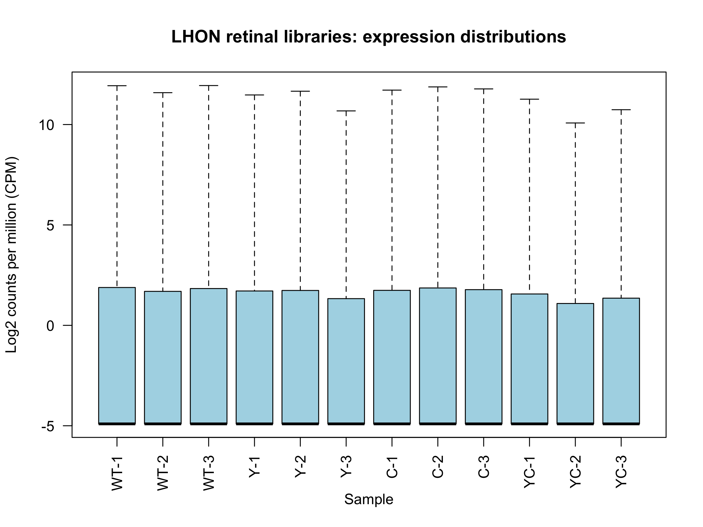
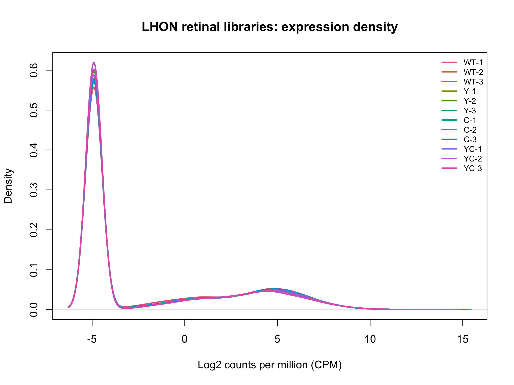
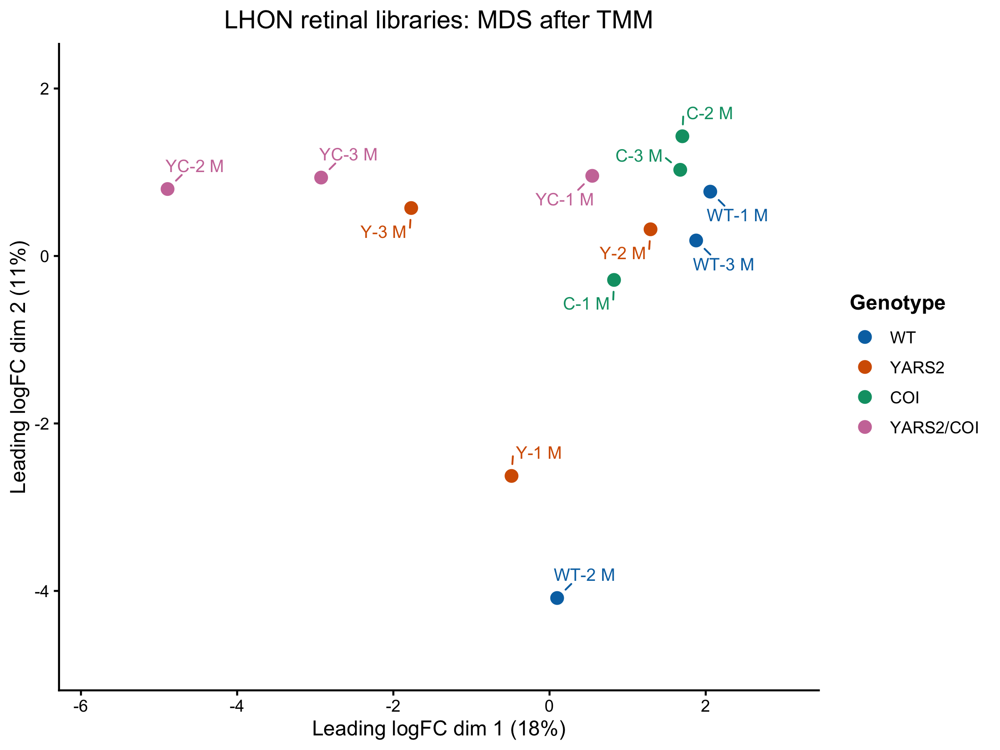
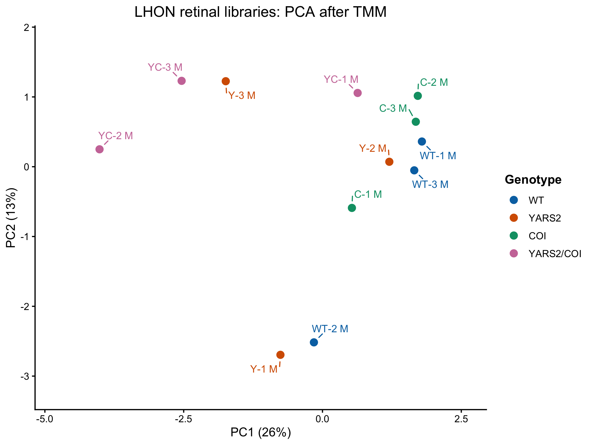

# LHON-linked model GSE304707: completed processed-data precheck

**Completed:** 30 October 2026, at the agreed endpoint.

**Decision:** Retain all 12 retinal libraries. The QC copy contains 17,860 gene rows. No library was established as failed by this precheck, and no further QC step is required by the recorded closure decision.

## Inputs and groups

The source is [GSE304707](https://www.ncbi.nlm.nih.gov/geo/query/acc.cgi?acc=GSE304707), the selected LHON-linked mitochondrial optic neuropathy model. This label describes the experimental model, rather than human patient retinal measurements.

The deposited CSV is `GSE304707_gene_count_matrix.csv`; the local metadata archive is `GSE304707_family`, containing `GSE304707_family.xml`. The original count matrix has 49,714 gene rows and 12 libraries. The four genotype labels are WT, YARS2, COI and YARS2/COI, with three libraries each. The matched records describe male, 12-month-old, C57BL/6J mouse retina throughout.

The [saved matched metadata](../metadata/GSE304707_samples_matched.csv) retains accessions, original titles/descriptions and the count-column names. These are labelled libraries; independent-animal, pooling and eye-to-library provenance were not established in the joint review. The principal mutant-versus-WT contrast remains a later analysis decision.

## Completed checks

| Component | Recorded result |
| --- | --- |
| Input structure | 49,714 rows, one gene-name field and 12 sample columns; numeric, finite, nonnegative, whole-valued counts; range 0–1,058,428 |
| Integrity | No missing values, blank/missing gene labels or duplicated labels reported in the completed checks |
| Sample matching | All sample identifiers matched uniquely; metadata and count-column order confirmed identical |
| Gene labels | Supplied symbol-style names preserved; aligned one-column gene annotation; no external ID mapping performed |
| Initial distributions | Boxplot and density reviewed; broad overlap, with a prominent low-expression floor from zero-count rows |
| Expression filtering | `filterByExpr` retained 17,860 rows and excluded 31,854 from the QC copy; all 12 libraries retained |
| Filtered alignment | Sample and annotation order preserved |
| TMM and log-CPM | Saved positive, finite factors range approximately 0.8933–1.0395; normalized matrix 17,860 by 12 |
| MDS | Pair-specific top 500 genes; displayed dimensions approximately 18% and 11% |
| PCA | One common set of 500 variable genes; displayed axes approximately 26% and 13% |
| Checkpoint | Final save and restore verification recorded: 47 objects, 7,258,085 bytes |

The expression filter uses the count-based settings already used in RP: `min.count = 10`, `min.total.count = 15`, and the four groups of three libraries. Gene-label spelling is not a filtering criterion. Supplied names remain usable within-study row keys; common-gene mapping and reference harmonization remain later comparison-preparation tasks.

## Recorded library summaries

Detected gene rows means count greater than zero before filtering. The TMM factors are copied from the exported final-session summary, without recalculation.

| Library | Group | Original total counts | Detected rows | TMM factor |
| --- | --- | ---: | ---: | ---: |
| WT-1 | WT | 58,198,613 | 18,414 | 1.0346641268 |
| WT-2 | WT | 55,648,273 | 17,115 | 1.0276024148 |
| WT-3 | WT | 62,610,347 | 17,567 | 1.0332944469 |
| Y-1 | YARS2 | 57,066,764 | 17,225 | 1.0394518134 |
| Y-2 | YARS2 | 56,650,041 | 17,167 | 1.0297145557 |
| Y-3 | YARS2 | 65,678,112 | 16,603 | 0.9224563084 |
| C-1 | COI | 64,270,432 | 17,518 | 1.0312509090 |
| C-2 | COI | 59,142,482 | 17,594 | 1.0388068632 |
| C-3 | COI | 57,719,140 | 17,372 | 1.0260724670 |
| YC-1 | YARS2/COI | 59,578,703 | 16,779 | 0.9863725255 |
| YC-2 | YARS2/COI | 60,653,727 | 15,851 | 0.8932679114 |
| YC-3 | YARS2/COI | 62,624,653 | 16,355 | 0.9518850137 |

The [exported TMM table](../tables/lhon/LHON_GSE304707_TMM_summary_2026-10-30.csv) also records library totals over retained gene rows. Those totals differ from the original all-row totals above. Scaling factors are not sample-quality scores, and estimating them does not overwrite retained raw counts.

## Figures and interpretation

The original PNG exports were visually inspected and copied unchanged during synchronization.

### Initial distributions

These views include all 49,714 original rows before filtering/TMM. Low medians and the dominant density peak are consistent with the large zero-count fraction. Broadly similar distributions do not establish similar gene-specific profiles.

### MDS after TMM

### PCA after TMM

WT-1/WT-3 and C-2/C-3 are nearby pairs in both views. WT-2 and Y-1 lie lower, while YC-2/YC-3 lie leftward and YC-1 farther right. Genotype separation is incomplete, with appreciable within-genotype variation and mixed-genotype neighbourhoods. These are descriptive readings of points in two-dimensional projections, not computed full-profile distance rankings or diagnoses of failed libraries.

Both projections summarize the same filtered/TMM data. Their different gene-selection rules can preserve broad relationships without giving identical distances. The displayed percentages refer to their respective representations, not genotype-attributable percentages, QC pass rates or fractions of differentially expressed genes. No disease/spaceflight resemblance score follows from these figures.

## Scope and limitations

The precheck concerns deposited processed counts and metadata; raw sequencing QC/alignment was not repeated. Gene symbols were preserved without external membership validation or cross-study harmonization. Retinal collection and RNA-extraction timing were not specified in the Characteristics and Extract-Protocol fields reviewed together; that bounded statement does not establish absence throughout the entire record or publication. See the [metadata notes](lhon-metadata-notes.md).

No differential-expression tests, pathway findings, final principal genotype contrast or comparison with OSD-758 was produced in this precheck. All 12 libraries remain retained.

## Saved state and reproducibility

The final checkpoint is `LHON_GSE304707_precheck_checkpoint_2026-10-30.RData`. The local completion record reports a successful save and restore check of 47 objects; synchronization confirmed the file exists but did not load it or repeat that check. The earlier 29 October checkpoint is a partial backup. Binary workspaces and downloaded counts remain outside Git.

The repository includes the [main teaching script](../scripts/05_LHON_GSE304707_precheck.R), [final reload script](../scripts/06_LHON_GSE304707_reload.R), [projection-style helper](../scripts/07_LHON_projection_style.R), [final save/export script](../scripts/08_LHON_GSE304707_save_final.R), and the [exported R session record](lhon-sessionInfo_2026-10-30.txt). See the [execution guide](running-the-lhon-precheck.md).

This report consolidates completed user-run outputs, saved tables, figures and the recorded restore check. Repository synchronization checked code syntax, portable-path adaptations, file consistency and links without importing expression inputs, loading RData, rerunning QC or generating plots. Original MaxineDrive files were preserved.

## Method documentation

- [edgeR reference manual](https://bioconductor.org/packages/release/bioc/manuals/edgeR/man/edgeR.pdf): count objects, expression filtering, CPM and TMM.
- [limma reference manual](https://bioconductor.org/packages/release/bioc/manuals/limma/man/limma.pdf): pairwise-gene MDS and common-gene PCA.
- [RNAseq123 workflow](https://bioconductor.org/packages/release/workflows/vignettes/RNAseq123/inst/doc/limmaWorkflow.html): established count preprocessing and sample exploration components. It does not validate the complete cross-disease project workflow.
