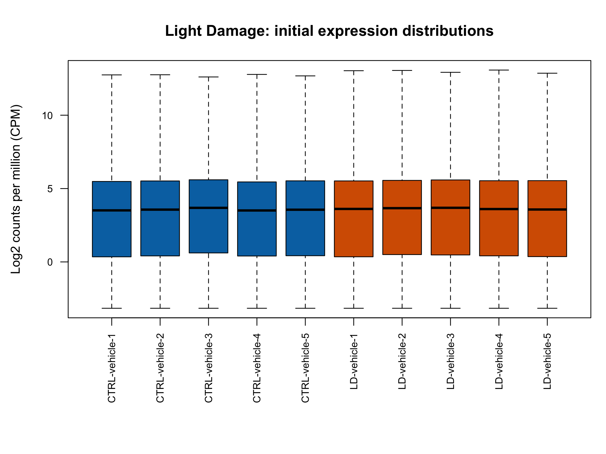
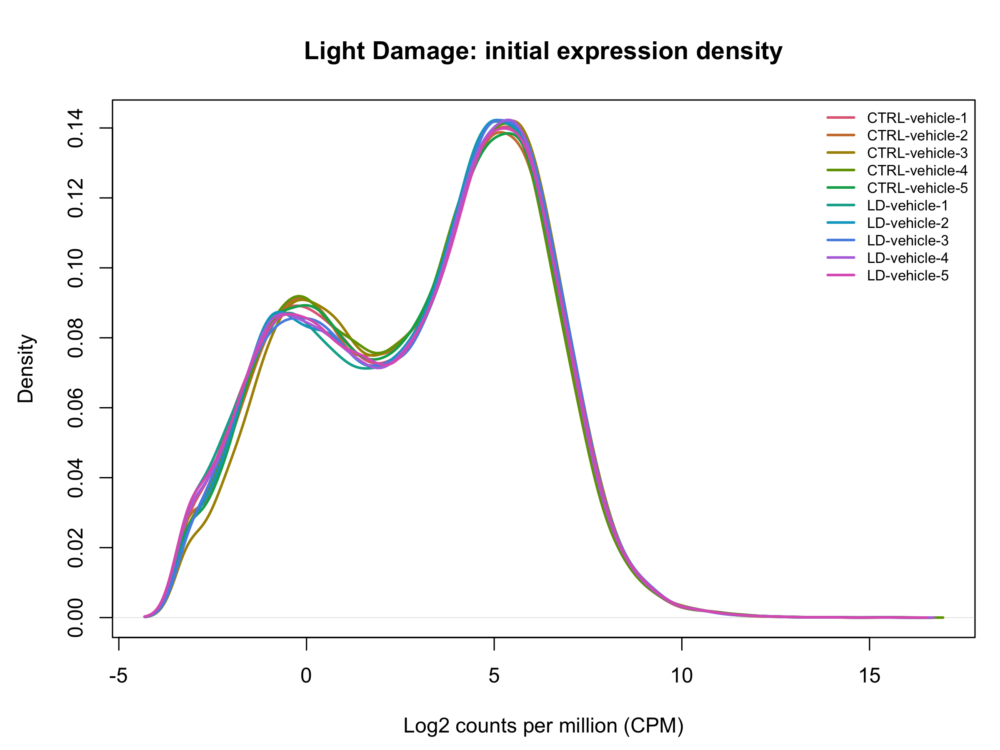
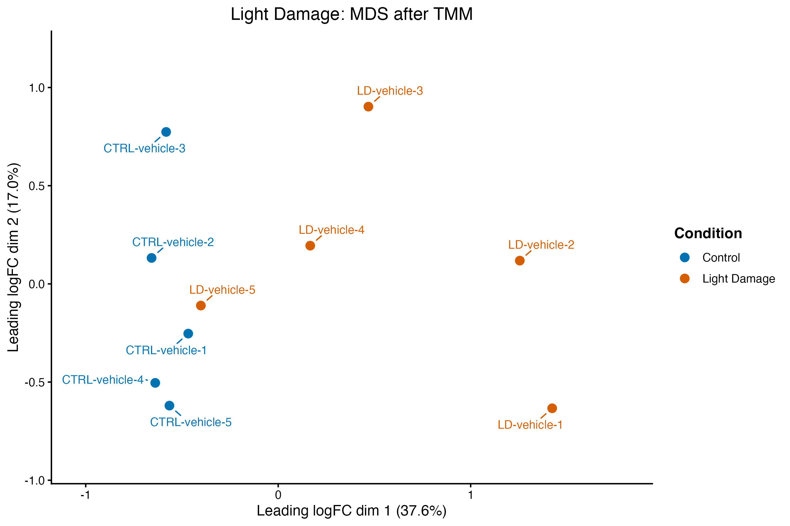
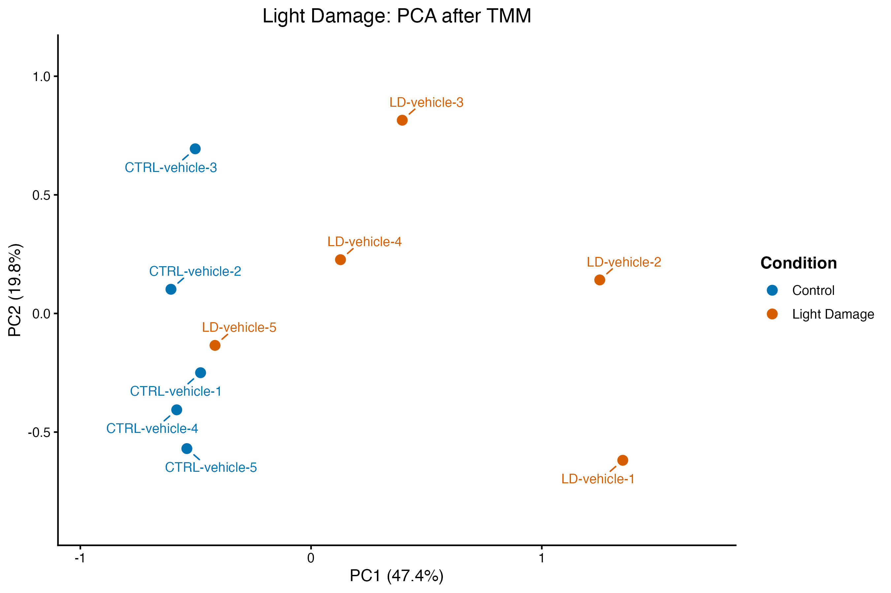

# Light-induced retinal damage GSE314043: completed precheck

**Completed:** 3 November 2026, in a separate R process. **Decision:** retain all 10 deposited libraries: five CTRL-vehicle and five LD-vehicle. LD-vehicle-5 remains included with its control-like projection position documented.

## Input, selection and design

[GSE314043](https://www.ncbi.nlm.nih.gov/geo/query/acc.cgi?acc=GSE314043) supplies RNA-seq gene counts in `GSE314043_genecount.txt`, with metadata in the locally named `GSE314043_family` archive. The matrix contains 19,999 supplied gene rows and 10 libraries. This row count describes the deposited table, not the total number of mouse genes.

The [selected metadata](../metadata/GSE314043_samples_selected.csv) is in exact count-column order. The deposited `genotype` field contains library labels, not biological genotypes; it is preserved as `genotype_recorded` and used as the sample key. All samples are mouse retina. Series design reports Balb/c mice; processing notes report GRCm39, Bowtie2 and RSEM 1.3.1. Raw-read alignment/quantification was not repeated.

The supplied comparison is LD-vehicle versus CTRL-vehicle, five measured libraries each. Although the series discusses P2RX7 inhibition, this matrix has no additional inhibitor-labelled libraries. Matching replicate numbers across conditions do not establish a paired design. All samples share the unexplained recorded batch string `12/1/2024`; it was preserved without converting it into a collection date, and no batch correction was applied.

Sex, age, exposure intensity/duration, collection interval and independent-animal/pooling provenance were not established in the inspected deposited fields. A verified study-specific publication was not established in the precheck record; details were not borrowed from another light-injury study.

## Integrity, annotation and normalization

| Component | Saved result |
| --- | --- |
| Input integrity | Numeric, finite, nonnegative, whole counts; no missing entries, blank or duplicate gene IDs |
| Count range | 0–1,008,714; 36 all-zero rows |
| Sample alignment | Exact metadata/count order; all 10 libraries retained |
| Initial distributions | All 19,999 rows; log2 CPM with `prior.count = 2`, before filtering/TMM |
| Native IDs | All 19,999 match the mouse Ensembl gene-ID pattern; original labels preserved |
| Expression filter | 16,852 retained, 3,147 excluded from the QC copy |
| TMM factors | Positive/finite, approximately 0.9550120–1.0458674 |
| Exploration matrix | Finite TMM-adjusted log-CPM, 16,852 × 10 |
| MDS | Pairwise top 500 genes; axes 37.6% and 17.0% |
| PCA | Common top 500 variable genes; axes 47.4% and 19.8% |

REST annotation attempts failed or timed out. Final annotation instead uses the official fixed [Ensembl release-116 GRCm39 GTF](https://ftp.ensembl.org/pub/release-116/gtf/mus_musculus/Mus_musculus.GRCm39.116.gtf.gz), whose assembly agrees with the deposited processing notes. Release 116 is the annotation used for this precheck; the original quantification annotation release remains unreported. The unsuccessful partial REST response was not used for the final annotation.

The [saved annotation](../tables/light_damage/Light_Damage_GSE314043_gene_annotation.csv) has one row per original ID: **19,878 named records, one record without a name** (`ENSMUSG00000095041`) **and 120 unmatched IDs**. It retains gene versions, biotypes, coordinates, species/assembly/release, source and lookup status. Original IDs were not replaced by names, collapsed or discarded because of missing annotation. [Provenance/checksum](../tables/light_damage/annotation_provenance.csv) and [unnamed/unmatched IDs](../tables/light_damage/unmapped_or_unnamed_gene_ids.csv) are included. See the [official GTF format documentation](https://www.ensembl.org/info/website/upload/gff.html) for feature and attribute fields.

Filtering uses the familiar group-aware `filterByExpr` settings, `min.count = 10` and `min.total.count = 15`, with the CTRL/LD condition factor. Original counts remain in separate raw objects. Retained-row library sizes are recalculated before TMM, followed by log-CPM with `prior.count = 2`. Missing gene names are not a filter criterion. The [sample-QC table](../tables/light_damage/Light_Damage_GSE314043_sample_QC.csv) records original assigned gene-count totals, detected rows, retained totals, factors and effective sizes.

## Figures and interpretation

The original boxplot already uses group colours; it was not included in the six-study restyle. All four PNGs below are unchanged copies of the completed exports.

Initial distributions overlap closely, with similar medians and spreads. The assigned gene-count totals range from approximately 14.65 to 20.70 million; positive-count genes range from 19,535 to 19,690. These are deposited gene-count summaries, not total sequenced reads or RNA-integrity measurements.

Both projections show partial condition separation and substantial LD variation. LD-vehicle-1/2 lie farthest from the control region along the first axis; LD-vehicle-3/4 lie between them and that region. LD-vehicle-5 is near controls, and CTRL-vehicle-3 differs on the second axis. The retained LD-vehicle-5 has an ordinary overall distribution, approximately 17.90 million assigned counts and 19,535 detected genes. No technical failure, relabelling or reason for its profile was established. No library was removed to strengthen separation.

The [saved coordinates](../tables/light_damage/Light_Damage_GSE314043_MDS_PCA_coordinates.csv), [axis percentages](../tables/light_damage/Light_Damage_GSE314043_MDS_PCA_variance.csv) and [PCA feature list](../tables/light_damage/Light_Damage_GSE314043_PCA_top500_genes.csv) preserve the completed results. Percentages describe each projection's variation, not the proportion of genes affected or resemblance to spaceflight.

## Saved verification and upload scope

The existing [verification record](light-damage-verification_2026-11-03.txt) reports successful fresh-process checkpoint restoration, sample/gene alignment, source-checksum preservation, exported-table agreement, absence of identical count profiles, compressed-GTF integrity, and PCA agreement with independent `prcomp` allowing axis sign and common scaling. These checks were recorded during completion; GitHub synchronization did not rerun them.

The final checkpoint `Light_Damage_GSE314043_precheck_checkpoint_2026-11-03.RData` exists locally (5,447,198 bytes). The [actual session record](light-damage-sessionInfo_2026-11-03.txt), selected metadata, [integrity results](../tables/light_damage/Light_Damage_GSE314043_integrity_checks.csv), annotation, [filter decisions](../tables/light_damage/Light_Damage_GSE314043_expression_filter.csv), sample summaries and projections are versioned. Original counts, normalized-expression binaries, the full GTF and RData remain local.

See the [main script](../scripts/20_Light_Damage_GSE314043_precheck.R), [reload helper](../scripts/21_Light_Damage_GSE314043_reload.R), [verification script](../scripts/22_Light_Damage_GSE314043_verify.R) and [execution guide](running-the-light-damage-precheck.md). Upload preparation checked syntax, portable paths, saved-table consistency and figure identity without importing expression inputs, loading workspaces, making annotation queries, refitting projections or regenerating figures. Differential expression, enrichment and disease–spaceflight comparisons remain later work.
