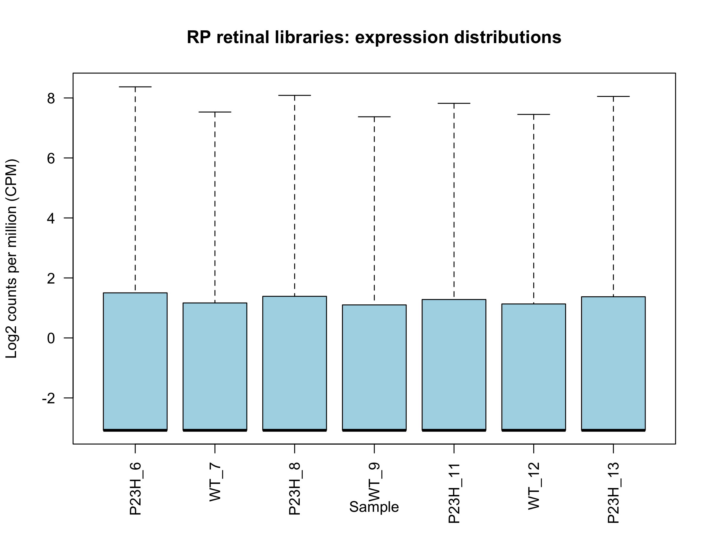
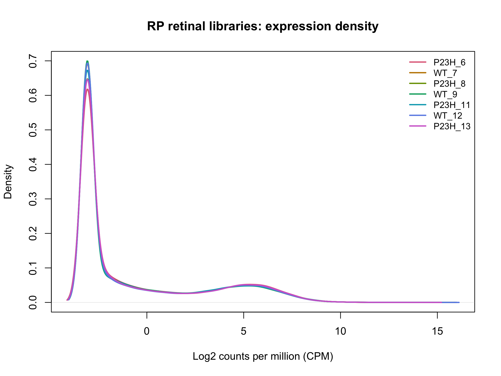
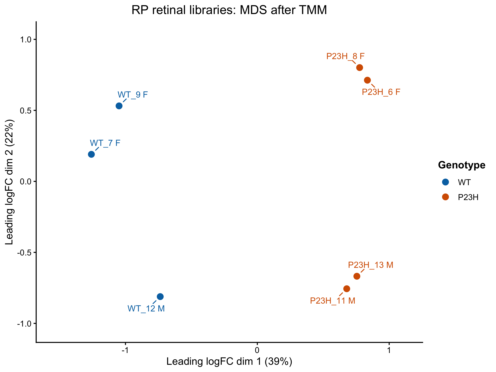
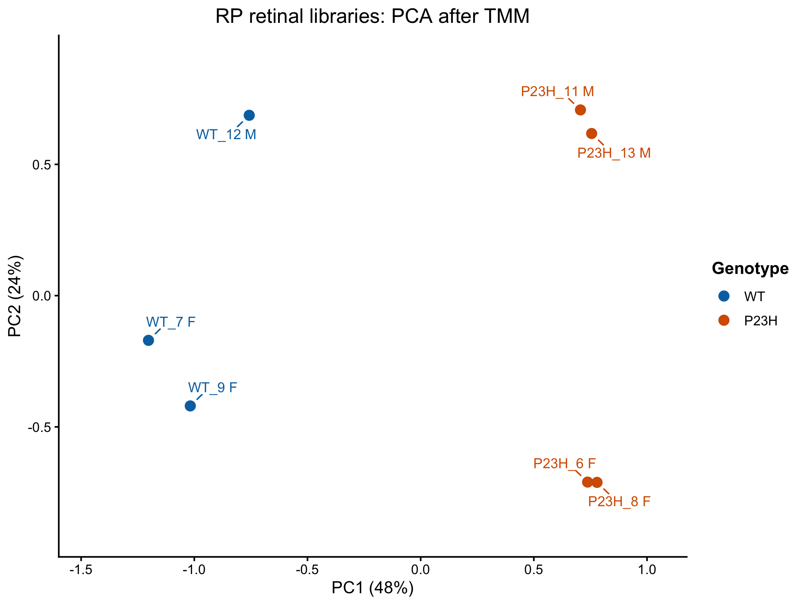

# Retinitis pigmentosa GSE156533: completed processed-data precheck

**Completed:** 29 October 2026, at the agreed endpoint after MDS and PCA interpretation.
**Decision:** Retain all seven retinal libraries. Preserve sex as a factor for later genotype comparisons. No sample has been established as a failed library from these checks.
**Checkpoint status:** Final dated checkpoint confirmed saved: RP_GSE156533_precheck_checkpoint_2026-10-29.RData, 9,637,922 bytes, 29 October 14:06. The recorded checkpoint audit confirmed 49 stored RP objects, including full/filtered data, normalization metadata and final projection plots. The earlier 10:16 checkpoint remains a backup through the initial boxplot stage.

## Inputs and study groups

- Input folder: `data/raw/Retinitis_Pigmentosa_GSE156533`, or the folder set by `RP_DATA_DIR`.
- Counts: GSE156533_readcounts_organized_by_largest_to_smallest_count.xlsx.
- Metadata download: extensionless GSE156533_family, a tar archive containing GSE156533_family.xml.
- Extracted XML: `results/retinitis_pigmentosa/metadata/GSE156533_family.xml`.
- Original imported table: 54,532 gene rows x 17 columns (gene ID, seven sample counts, nine gene annotations).
- Selected comparison: four RhoP23H/WT mutant libraries versus three RhoWT wild-type libraries.
- Mutant group: two female and two male libraries; WT: two female and one male library.
- All samples: postnatal day 90, whole retina, C57BL/6J.
- Count-column order: P23H_6, WT_7, P23H_8, WT_9, P23H_11, WT_12, P23H_13.

The source XML contains five Characteristics labels, each recorded for all seven samples: genotype/variation, Sex, age, tissue and strain background. Treatment/extraction protocols were also inspected. Source-order and count-matched metadata remain separate objects.

## Completed checks and findings

| Check | Observed finding |
|---|---|
| Count structure | 54,532 x 7; numeric, finite, nonnegative, whole-valued counts; range 0–670,529 |
| Sample matching | Sample IDs matched uniquely and metadata/count-column order identical |
| Gene IDs | No missing/blank IDs or duplicates; all 54,532 have the expected mouse Ensembl gene-ID structure |
| Gene annotation | 54,532 x 10; exact count-row alignment; no blanks; 43 missing gene descriptions and no NA values in the other fields |
| Initial distributions | Boxplot/density broadly comparable across samples; more than half the original rows per sample have zero counts, explaining the low medians and density peak |
| Expression filtering | filterByExpr retained 17,351 rows and excluded 37,181 from the QC copy; all seven samples retained |
| Filtered alignment | Both sample order and gene-annotation order confirmed TRUE |
| Normalization | TMM-adjusted log-CPM used for MDS/PCA; stored sample summary later verified from the final checkpoint, with factors approximately 0.941–1.085 |
| MDS | Pair-specific top 500 divergent genes; dimensions 1 and 2 labelled 39% and 22% |
| PCA | One common set of 500 most variable genes; PC1/PC2 labelled 48% and 24% |
| Figure layout | Final projections use actual sample points, separated sex-labelled names, connector lines and outside legends; revised PNGs visually inspected |

Gene descriptions were not used as a filtering criterion. An expected ID format is a structural check, not external Ensembl membership validation or completed cross-study gene harmonisation.

### Original-library summaries

Detected gene rows here means raw count > 0, before statistical expression filtering.

| Sample | GEO accession | Genotype group | Sex | Total counts | Detected gene rows |
|---|---|---|---|---:|---:|
| P23H_6 | GSM4733112 | P23H | Female | 15,469,799 | 25,694 |
| WT_7 | GSM4733116 | WT | Female | 16,695,962 | 24,518 |
| P23H_8 | GSM4733113 | P23H | Female | 18,022,977 | 25,094 |
| WT_9 | GSM4733117 | WT | Female | 17,758,147 | 24,550 |
| P23H_11 | GSM4733114 | P23H | Male | 14,709,319 | 24,360 |
| WT_12 | GSM4733118 | WT | Male | 18,315,284 | 24,771 |
| P23H_13 | GSM4733115 | P23H | Male | 17,401,717 | 25,317 |

### Stored TMM metadata after expression filtering

These values were read from the final checkpoint's existing rp_tmm_summary. Library sizes below are totals over retained gene rows; they differ from the original all-row totals above. No normalization was recomputed for this audit.

| Sample | Retained-gene library total | TMM factor |
|---|---:|---:|
| P23H_6 | 15,441,086 | 1.0847612352 |
| WT_7 | 16,671,496 | 0.9590682454 |
| P23H_8 | 17,994,383 | 1.0374148473 |
| WT_9 | 17,730,954 | 0.9409120709 |
| P23H_11 | 14,687,307 | 0.9914016485 |
| WT_12 | 18,289,591 | 0.9548360305 |
| P23H_13 | 17,374,027 | 1.0402468192 |

## Preparation and interpretation to preserve

Filtering used min.count=10 and min.total.count=15, explicitly supplied documented edgeR defaults. The original median library size gives a CPM cutoff of approximately 0.574656, required in at least three of the seven samples, plus 15 total counts. Three derives from the smaller genotype group size; qualifying samples need not all belong to one genotype. These thresholds were set before the retained-gene count was observed. Original full counts and the unfiltered DGEList remain available.

TMM scaling was applied to the filtered QC DGEList. Raw retained count entries stay as counts; a separate rp_log_cpm_qc matrix supplies normalized log-expression values for exploration. Finite/positive factor and finite log-CPM checks were included in the code run before the plots. The factor table was subsequently read directly from the saved rp_tmm_summary object, without recalculation: factors range from 0.9409120709 to 1.0847612352. These are modest additional scaling adjustments, not sample-quality scores.

Both MDS and PCA show clear WT/P23H separation horizontally and sex-associated structure vertically. The P23H female pair and male pair remain close under both gene-selection approaches. WT_12 is the sole male WT; its separation from female WT samples follows the male-associated pattern in P23H and does not itself diagnose a failed library.

PCA's approximately 72% combined refers to variation in the selected common 500 genes' log-expression values. MDS's approximately 61% refers to its own distance representation. These percentages are not causal allocations to genotype/sex or QC pass rates. The vertical orientation reverses between the plots, which has no biological meaning. The two methods summarize the same libraries and are not independent validation.

Retain all seven libraries and account for sex in later genotype comparisons. No differential-expression tests, pathway findings, disease ranking or RP/spaceflight resemblance score were produced in this precheck. The later comparison objective remains within-study disease responses versus the fixed mouse retinal spaceflight reference.

## Scope and source limitations

This precheck concerns deposited processed counts and metadata; original raw-read QC/alignment was not repeated. GEO does not explicitly establish eyes-per-library/laterality in the inspected record. The original paper's general RNA-seq methods mention RNAlater/HiSeq, whereas this cohort's GEO metadata records liquid-nitrogen freezing/NovaSeq. Preserve this source discrepancy without inventing its explanation or changing the chosen input. These differences remain recorded as source limitations; they were not resolved by changing inputs.

## Saved figures

All four figures below are the original reviewed PNG exports, copied unchanged. The initial distribution plots include all 54,532 gene rows; MDS/PCA use the filtered, TMM-adjusted QC preparation.

### Initial log-CPM boxplot

### Initial log-CPM density

### MDS after TMM

The pairwise-gene view shows dimensions labelled 39% and 22%. Colours identify genotype, while F/M labels retain the recorded sex.

### PCA after TMM

The common-top-500-gene view shows PC1 48% and PC2 24%. Points are the original sample coordinates; repelled labels and outside legends improve readability.

## Scripts, sample metadata and checkpoint

- [Main interactive precheck](../scripts/02_Retinitis_Pigmentosa_GSE156533_precheck.R).
- [Recovery helper](../scripts/03_Retinitis_Pigmentosa_GSE156533_reload.R), which reconstructs the initial-boxplot stage from source inputs.
- [Shared projection styling](../scripts/04_Restyle_Retinal_MDS_PCA.R), which reuses stored coordinates for RP MDS and glaucoma MDS/PCA.
- [Matched seven-library metadata](../metadata/GSE156533_samples_matched.csv), extracted from the existing public GEO XML and arranged in the recorded count-column order.
- [Execution and checkpoint instructions](running-the-rp-precheck.md).

The local output folder is `results/retinitis_pigmentosa/`. The final checkpoint is `RP_GSE156533_precheck_checkpoint_2026-10-29.RData` (9,637,922 bytes). The existing source-summary audit records 49 stored RP objects, confirmed original/filtered dimensions, stored projection modes and the normalization metadata listed above. The GitHub synchronization confirmed file presence but did not load the workspace or repeat that audit. The earlier checkpoint remains a backup. Workspace binaries are excluded from Git.

The explicit final save list includes annotations, grouping, unfiltered/filtered DGELists, expression mask, TMM metadata, normalized log-CPM, density objects, projections and final plots/helpers. It excludes XML external pointers and the large isolated glaucoma environment. The portable main script initializes the checkpoint base-list when needed, using the list from the recovery helper; this bookkeeping change does not alter expression calculations. For a fresh run, complete the shared styling step before the final save so the styled MDS object is available.

This report consolidates the author's recorded outputs, saved figures and existing checkpoint audit. Repository synchronization inspected the images, checked code syntax and extracted the small public sample table. It did not read the expression workbook, load R workspaces, recompute QC or generate plots. The original source summary and working scripts are preserved; their historical pending comments are superseded by the final completion record here.

## Method references

- [edgeR reference manual](https://bioconductor.org/packages/release/bioc/manuals/edgeR/man/edgeR.pdf): DGEList, CPM, filterByExpr and TMM.
- [limma reference manual](https://bioconductor.org/packages/release/bioc/manuals/limma/man/limma.pdf): pairwise MDS and common-gene PCA.
- [RNAseq123 workflow](https://bioconductor.org/packages/release/workflows/vignettes/RNAseq123/inst/doc/limmaWorkflow.html): established filtering, normalization and exploration workflow.
- [Leinonen et al., eLife 2020](https://elifesciences.org/articles/59422): original study and cohort context; it does not validate the complete project pipeline.
