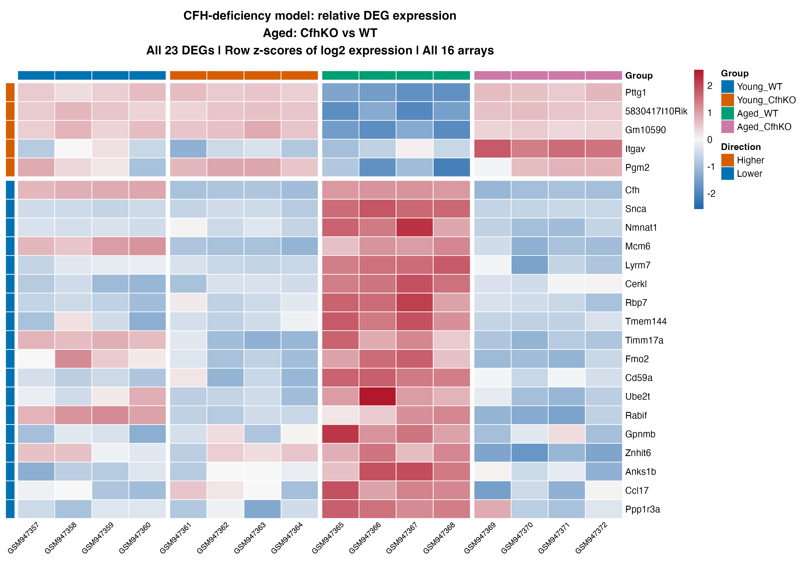
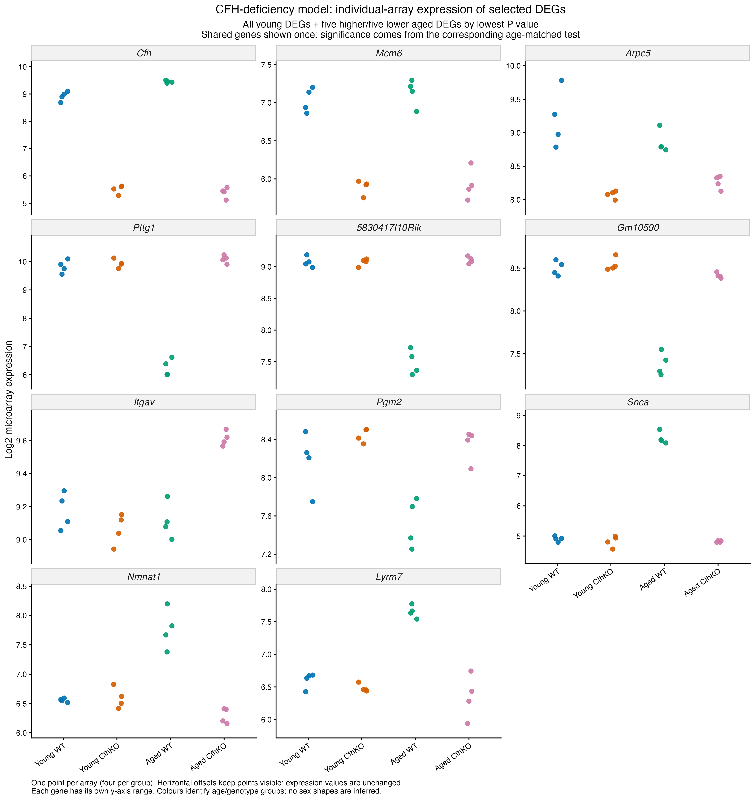
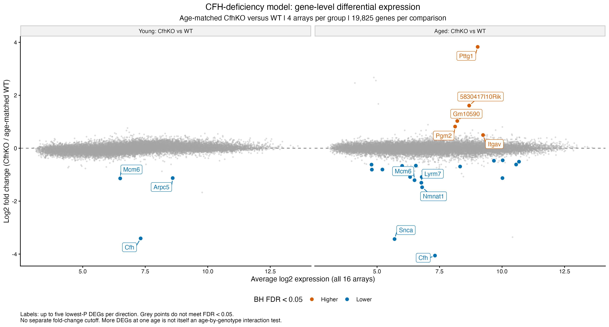
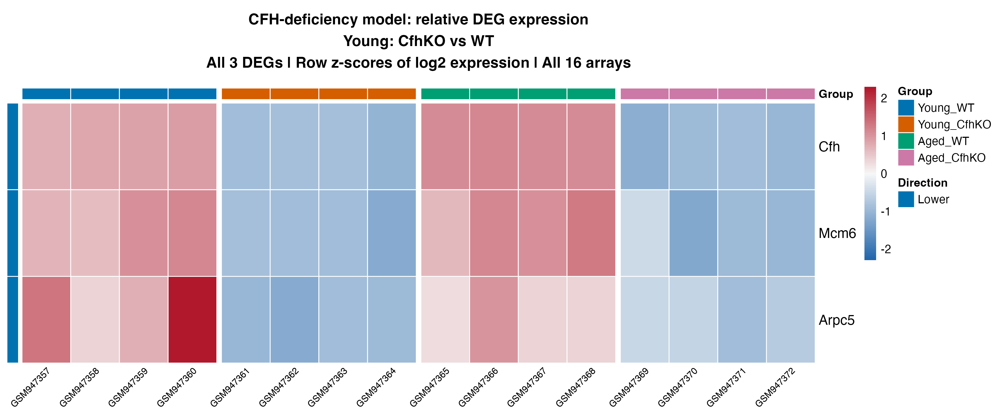
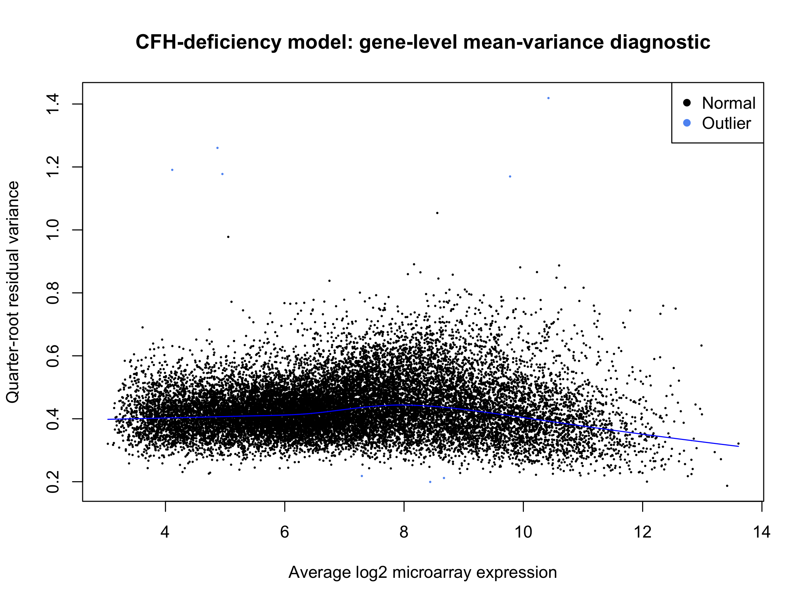

# AMD-related CFH-deficiency model (GSE38671): within-study results

Recorded results uploaded 5 November 2026. Source: [GSE38671](https://www.ncbi.nlm.nih.gov/geo/query/acc.cgi?acc=GSE38671).

Age-matched Young CfhKO versus Young WT and Aged CfhKO versus Aged WT use all 16 selected neuroretina arrays, four per group. RPE/choroid remains excluded by tissue selection. The original precheck log2 values are reused, without another logarithm, CPM, TMM, new normalization, array weighting or sample removal. GSM947360 remains included with its earlier review flag.

## Model and saved result summary

**Model:** limma-trend robust empirical Bayes; four age/genotype groups. The design has 16 samples and 4 estimable terms (12 nominal residual degrees of freedom). In the current edgeR pipeline, gene-specific effective degrees of freedom can differ from this design calculation.

| Comparison | Tested | DEGs | Higher | Lower |
| --- | ---: | ---: | ---: | ---: |
| Young_CfhKO_vs_WT | 19,825 | 3 | 0 | 3 |
| Aged_CfhKO_vs_WT | 19,825 | 23 | 5 | 18 |

The criterion is BH-adjusted FDR < 0.05 within each contrast, without an extra fold-change cutoff. Higher/lower refers to the first named condition relative to its control. Nonsignificant genes remain in complete and ranked tables; failure to meet FDR is not proof of no response. [Saved result tables](../../tables/withinstudy/amd/) preserve the numerical outputs.

## Identifiers and rankings

This completed analysis is gene-level, following the earlier array-feature analysis. Of 35,556 features, the saved audit records 10,158 without a gene ID, 22,610 with one distinct recorded ID and 2,788 with multiple IDs. The conservative eligibility rule requires one ID, no truncation and no missing-ID assignment record: 21,016 features qualify. They represent 19,825 recorded Entrez IDs. For each gene, the highest mean log2-expression feature across all 16 arrays is selected, with ascending feature ID as the tie rule, independently of significance and fixed for both ages. Supplied symbols/IDs are preserved without a new database update. Mapping and representative-selection audits are versioned. The final variance moderation/BH adjustment is estimated on this gene-level input, so the new 3/23 gene counts are not a relabelling of the older 5/51 significant array-feature counts. Full rankings use signed moderated t.

## Saved figures

Five current gene-level figures include a mean–variance diagnostic, two-panel MD overview, all-three-young-DEG heatmap, all-23-aged-DEG heatmap and 11-gene individual-array dot plot. Heatmap scaling uses all 16 arrays. Earlier feature-level diagnostic/summary/subset tables are retained in feature_level_history. The two large earlier complete feature tables remain local; current full gene-level results are uploaded.

## Saved state and scope

Final gene-level 5 November checkpoint, actual session export and existing verification record are present. The existing record reports checks of mapping eligibility, representative maxima/ties, input preservation, contrasts, BH FDR, rankings and plotted values. Upload preparation did not rerun those checks or refit models.

[Scripts](../../scripts/withinstudy/amd/) retain the original modelling expressions with portable input/output/helper paths. [Execution instructions](running-the-analysis.md) explain local checkpoint requirements and saved-path handling. Binary workspaces and original expression inputs stay local. Original PNGs were copied byte-for-byte; the upload checked saved-table consistency and syntax without executing analysis or loading model workspaces.

Heatmaps describe selected genes relative to each gene's own mean. Diagnostic outlier flags refer to gene variability, not failed samples. DEG totals do not measure disease severity or resemblance to spaceflight, and selected-gene figures are not independent validation. No pathway enrichment or comparison with OSD-758 is included in this stage. See the [shared methods and scope](README.md#methods-and-interpretation).
