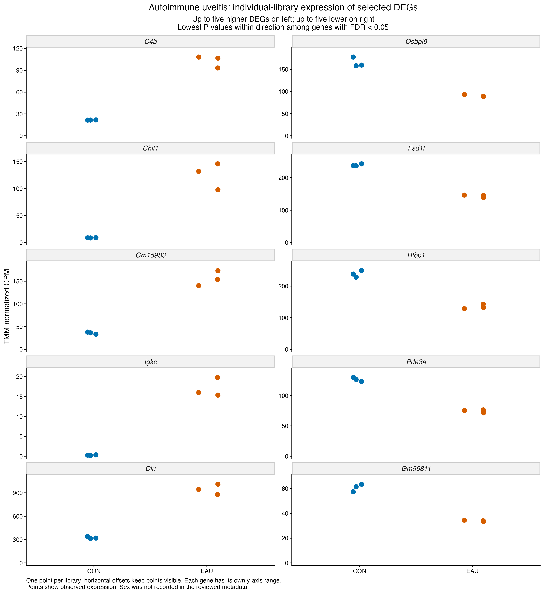
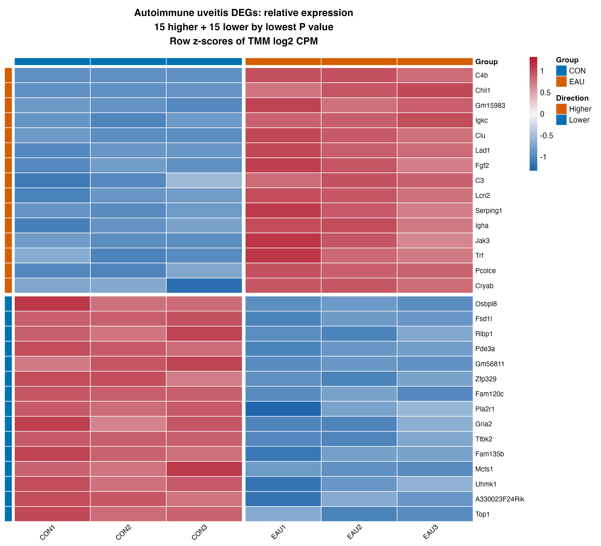
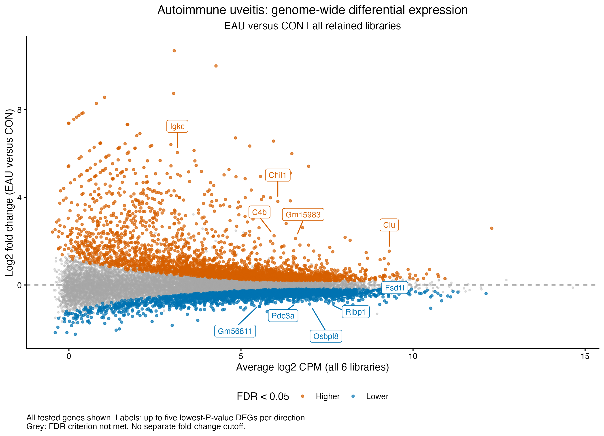
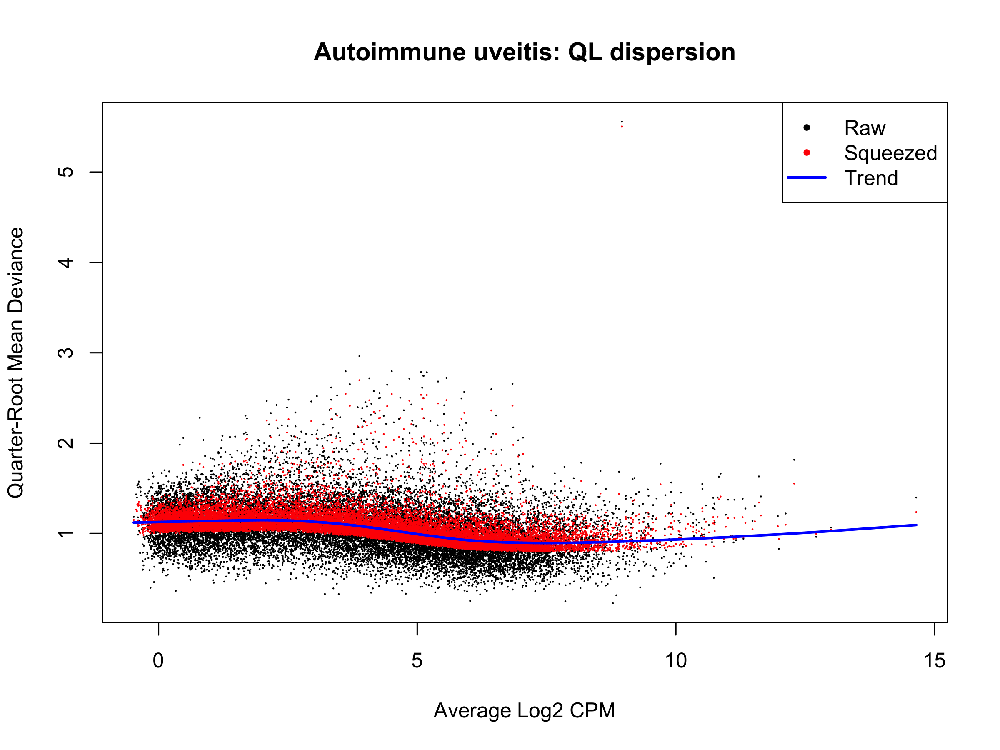

# Experimental autoimmune uveitis (GSE284505): within-study results

Recorded results uploaded 5 November 2026. Source: [GSE284505](https://www.ncbi.nlm.nih.gov/geo/query/acc.cgi?acc=GSE284505).

EAU versus CON uses all six selected libraries, three per group, with 18,187 filtered count rows and saved TMM factors. Both sleep-deprivation groups remain outside the contrast. Sex, collection timing and animal/pooling provenance were not established in the reviewed fields, so no sex or pairing category is inferred.

## Model and saved result summary

**Model:** edgeR robust QL; ~ group. The design has 6 samples and 2 estimable terms (4 nominal residual degrees of freedom). In the current edgeR pipeline, gene-specific effective degrees of freedom can differ from this design calculation.

| Comparison | Tested | DEGs | Higher | Lower |
| --- | ---: | ---: | ---: | ---: |
| EAU_vs_CON | 18,187 | 5,464 | 2,966 | 2,498 |

The criterion is BH-adjusted FDR < 0.05 within each contrast, without an extra fold-change cutoff. Higher/lower refers to the first named condition relative to its control. Nonsignificant genes remain in complete and ranked tables; failure to meet FDR is not proof of no response. [Saved result tables](../../tables/withinstudy/autoimmune_uveitis/) preserve the numerical outputs.

## Identifiers and rankings

Mixed source AccID labels are preserved as unique keys, including symbol-style and Ensembl IDs. Existing REST annotation is reused; missing display names fall back to source identifiers, which are not newly verified symbol mappings. All tested rows receive signed square-root F rankings. No new annotation queries or cross-study ID harmonization are performed.

## Saved figures

The heatmap shows 15 higher and 15 lower DEGs by P value, and the dot plots show five per direction. Each dot is one library’s observed non-log TMM CPM; heatmap colours are row z-scores of normalized log-CPM. Labels on the MD plot identify selected lowest-P hits and retain actual coordinates.

## Saved state and scope

Final 5 November checkpoint, actual session export and existing fresh-process verification record are present. The saved record reports count/TMM identity, result/rank consistency, plot-value checks and reload success; upload preparation did not rerun it.

[Scripts](../../scripts/withinstudy/autoimmune_uveitis/) retain the original modelling expressions with portable input/output/helper paths. [Execution instructions](running-the-analysis.md) explain local checkpoint requirements and saved-path handling. Binary workspaces and original expression inputs stay local. Original PNGs were copied byte-for-byte; the upload checked saved-table consistency and syntax without executing analysis or loading model workspaces.

Heatmaps describe selected genes relative to each gene's own mean. Diagnostic outlier flags refer to gene variability, not failed samples. DEG totals do not measure disease severity or resemblance to spaceflight, and selected-gene figures are not independent validation. No pathway enrichment or comparison with OSD-758 is included in this stage. See the [shared methods and scope](README.md#methods-and-interpretation).
