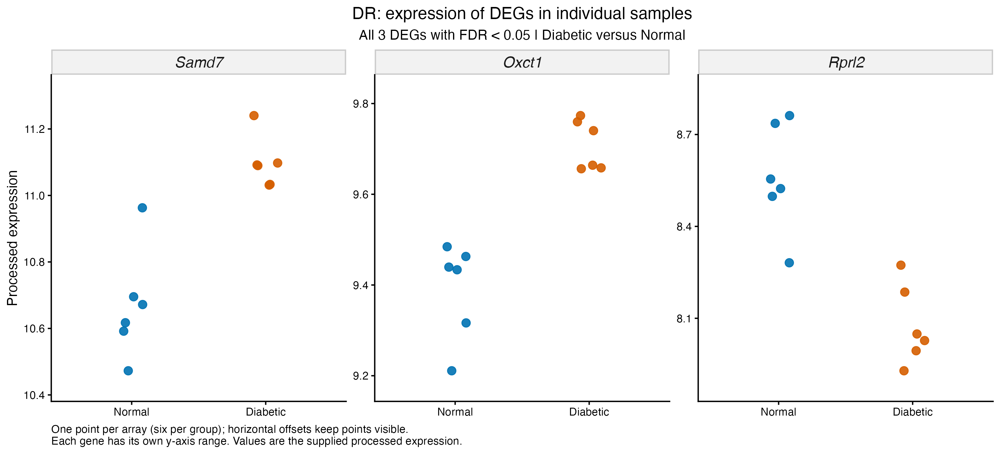
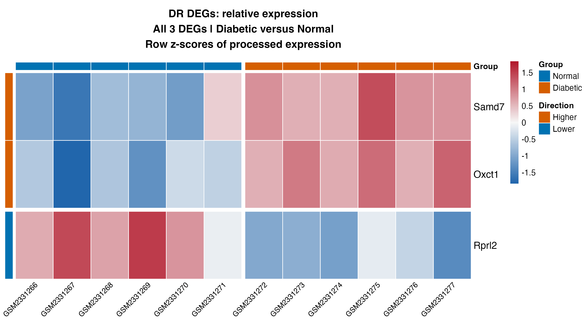
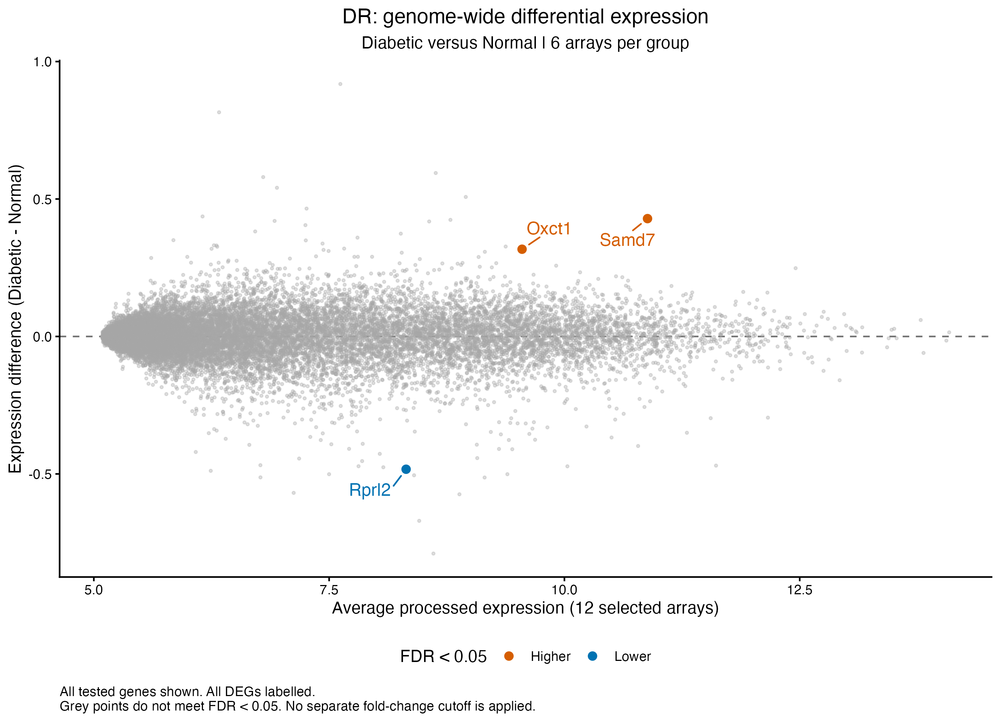
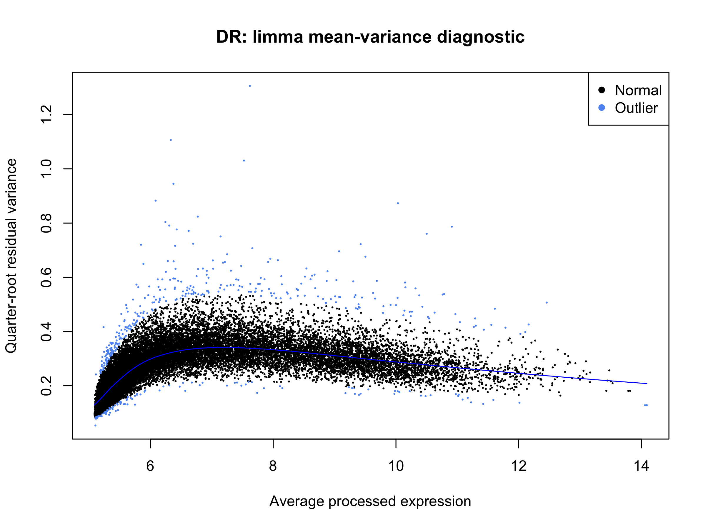

# Diabetic retinopathy (GSE87433): within-study results

Recorded results uploaded 5 November 2026. Source: [GSE87433](https://www.ncbi.nlm.nih.gov/geo/query/acc.cgi?acc=GSE87433).

The primary contrast is six untreated diabetic arrays versus six normal arrays, excluding the five transplantation/insulin-treated arrays used in exploratory prechecks. All 24,973 supplied features are tested using the deposited processed microarray values. No additional log2 transformation, CPM calculation, TMM normalization or RNA-seq count filter is performed.

## Model and saved result summary

**Model:** limma-trend robust empirical Bayes; ~ group. The design has 12 samples and 2 estimable terms (10 nominal residual degrees of freedom). In the current edgeR pipeline, gene-specific effective degrees of freedom can differ from this design calculation.

| Comparison | Tested | DEGs | Higher | Lower |
| --- | ---: | ---: | ---: | ---: |
| Diabetic_vs_Normal | 24,973 | 3 | 2 | 1 |

The criterion is BH-adjusted FDR < 0.05 within each contrast, without an extra fold-change cutoff. Higher/lower refers to the first named condition relative to its control. Nonsignificant genes remain in complete and ranked tables; failure to meet FDR is not proof of no response. [Saved result tables](../../tables/withinstudy/diabetic_retinopathy/) preserve the numerical outputs.

## Identifiers and rankings

Entrez-based ID/ENTREZ_GENE_ID values retain their supplied platform symbols and annotations. All genes are ranked using the signed moderated t statistic from limma. This differs from the project-specific signed square-root F ranking used for edgeR count analyses.

## Saved figures

The three DEGs are Samd7 and Oxct1 (higher) and Rprl2 (lower). The heatmap and dot plots show all three across the 12 selected arrays. Dot values are supplied processed expression; heatmap colours are row z-scores. The microarray variability figure is a limma mean–variance diagnostic, with gene-variance flags, rather than an edgeR QL plot.

## Saved state and scope

Final dated 5 November checkpoint and actual session export are present; synchronization confirmed presence without loading them.

[Scripts](../../scripts/withinstudy/diabetic_retinopathy/) retain the original modelling expressions with portable input/output/helper paths. [Execution instructions](running-the-analysis.md) explain local checkpoint requirements and saved-path handling. Binary workspaces and original expression inputs stay local. Original PNGs were copied byte-for-byte; the upload checked saved-table consistency and syntax without executing analysis or loading model workspaces.

Heatmaps describe selected genes relative to each gene's own mean. Diagnostic outlier flags refer to gene variability, not failed samples. DEG totals do not measure disease severity or resemblance to spaceflight, and selected-gene figures are not independent validation. No pathway enrichment or comparison with OSD-758 is included in this stage. See the [shared methods and scope](README.md#methods-and-interpretation).
