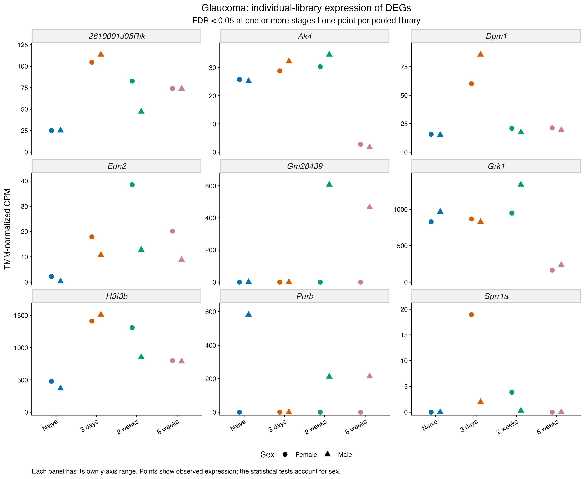
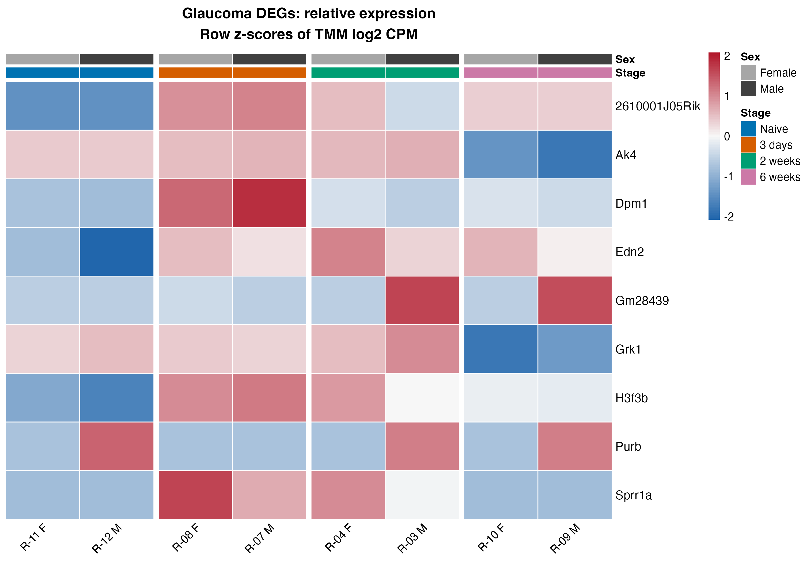
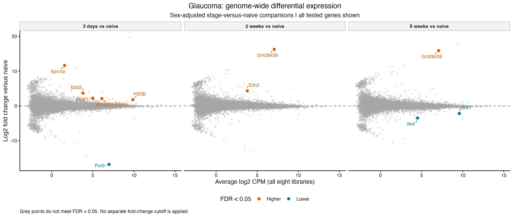
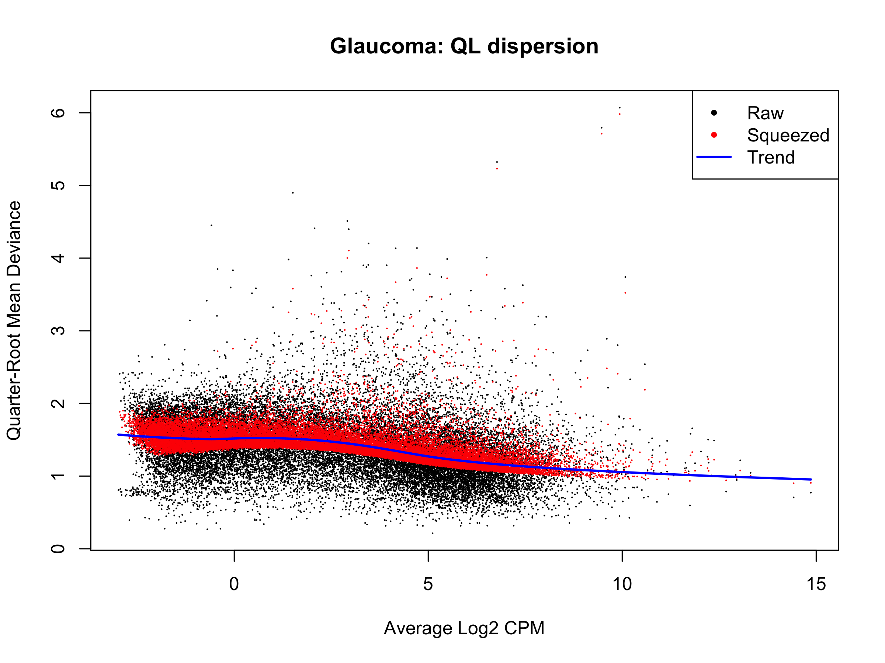

# Glaucoma (GSE241782): within-study results

Recorded results uploaded 5 November 2026. Source: [GSE241782](https://www.ncbi.nlm.nih.gov/geo/query/acc.cgi?acc=GSE241782).

The three comparisons are glaucoma at 3 days, 2 weeks and 6 weeks versus naïve baseline. The input is the saved 23,301-row filtered count object and its TMM factors; precheck filtering/normalization are reused. Each stage/reference has one female and one male pooled library. The additive sex term accounts for a shared sex effect; pooled libraries are the measured observations, rather than four separate animals per group. All eight selected libraries, including R-08, remain included.

## Model and saved result summary

**Model:** edgeR robust QL; ~ sex + group. The design has 8 samples and 5 estimable terms (3 nominal residual degrees of freedom). In the current edgeR pipeline, gene-specific effective degrees of freedom can differ from this design calculation.

| Comparison | Tested | DEGs | Higher | Lower |
| --- | ---: | ---: | ---: | ---: |
| 3D versus naive | 23,301 | 6 | 5 | 1 |
| 2W versus naive | 23,301 | 2 | 2 | 0 |
| 6W versus naive | 23,301 | 3 | 1 | 2 |

The criterion is BH-adjusted FDR < 0.05 within each contrast, without an extra fold-change cutoff. Higher/lower refers to the first named condition relative to its control. Nonsignificant genes remain in complete and ranked tables; failure to meet FDR is not proof of no response. [Saved result tables](../../tables/withinstudy/glaucoma/) preserve the numerical outputs.

## Identifiers and rankings

Original combined Ensembl/symbol labels remain traceable through original_label, ensembl_id and gene_symbol. Full rankings use the project-specific signed square-root F score. Reviewed negligible negative F values are treated as zero for ranking only, within sqrt(.Machine$double.eps); the original F/PValue/FDR columns remain unchanged. The guard is not a significance threshold.

## Saved figures

The heatmap and individual-library plots show the nine distinct genes significant at one or more stages. The MD panels show all tested genes separately for each stage. Sex shapes and stage colours refer to the recorded pooled libraries.

## Saved state and scope

Final dated 4 November checkpoint confirmed present. Earlier fit/results checkpoints are intermediate stages; use the final reload helper for the completed state.

[Scripts](../../scripts/withinstudy/glaucoma/) retain the original modelling expressions with portable input/output/helper paths. [Execution instructions](running-the-analysis.md) explain local checkpoint requirements and saved-path handling. Binary workspaces and original expression inputs stay local. Original PNGs were copied byte-for-byte; the upload checked saved-table consistency and syntax without executing analysis or loading model workspaces.

Heatmaps describe selected genes relative to each gene's own mean. Diagnostic outlier flags refer to gene variability, not failed samples. DEG totals do not measure disease severity or resemblance to spaceflight, and selected-gene figures are not independent validation. No pathway enrichment or comparison with OSD-758 is included in this stage. See the [shared methods and scope](README.md#methods-and-interpretation).
