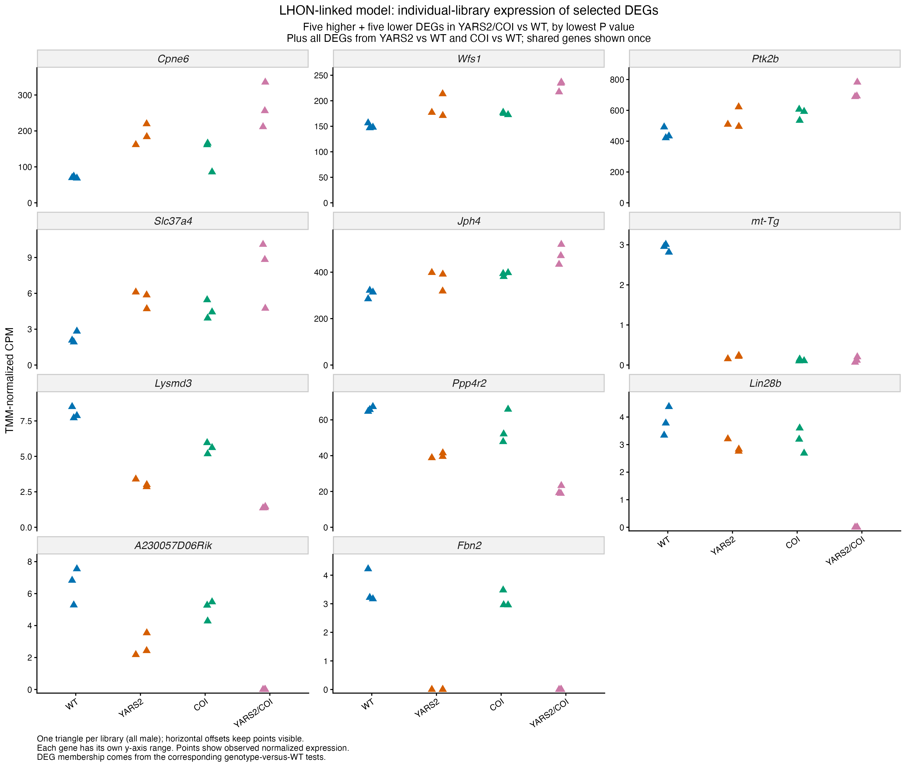
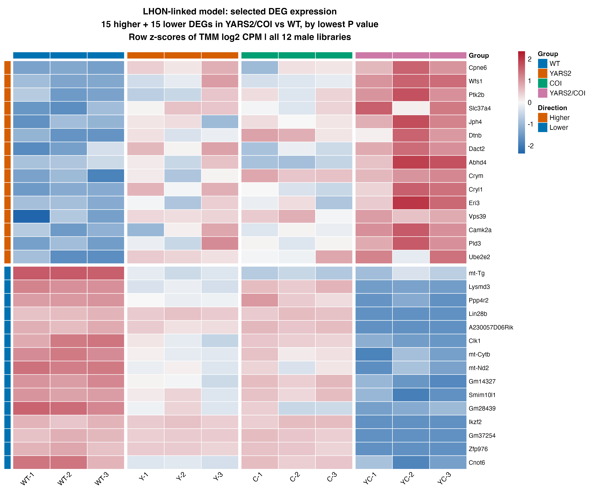
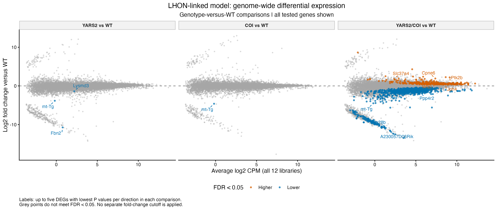
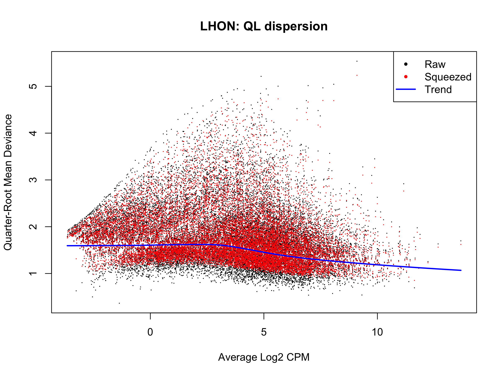

# LHON-linked model (GSE304707): within-study results

Recorded results uploaded 5 November 2026. Source: [GSE304707](https://www.ncbi.nlm.nih.gov/geo/query/acc.cgi?acc=GSE304707).

Three predefined contrasts compare YARS2, COI and YARS2/COI separately with WT. All 12 libraries remain included, three per group, recorded as male and 12 months old. The model reuses the 17,860-row filtered count object and its TMM factors. A sex term is not fitted because sex is constant.

## Model and saved result summary

**Model:** edgeR robust QL; ~ group. The design has 12 samples and 4 estimable terms (8 nominal residual degrees of freedom). In the current edgeR pipeline, gene-specific effective degrees of freedom can differ from this design calculation.

| Comparison | Tested | DEGs | Higher | Lower |
| --- | ---: | ---: | ---: | ---: |
| YARS2_vs_WT | 17,860 | 3 | 0 | 3 |
| COI_vs_WT | 17,860 | 1 | 0 | 1 |
| YARS2_COI_vs_WT | 17,860 | 1,209 | 324 | 885 |

The criterion is BH-adjusted FDR < 0.05 within each contrast, without an extra fold-change cutoff. Higher/lower refers to the first named condition relative to its control. Nonsignificant genes remain in complete and ranked tables; failure to meet FDR is not proof of no response. [Saved result tables](../../tables/withinstudy/lhon/) preserve the numerical outputs.

## Identifiers and rankings

The supplied symbol-style gene_name field remains the row key. All tested genes are ranked separately for each contrast using the signed square-root F score. All three genotype responses are retained; these contrasts do not test a formal YARS2-by-COI interaction.

## Saved figures

The three-panel MD figure shows each genotype-versus-WT test. The heatmap displays 15 higher and 15 lower DEGs from the double-mutant comparison across all 12 libraries. Dot plots include five higher/five lower double-mutant DEGs plus all single-mutant hits, with shared genes shown once; 11 genes are displayed.

## Saved state and scope

Final dated 5 November checkpoint and actual session export are present; synchronization confirmed presence without loading them.

[Scripts](../../scripts/withinstudy/lhon/) retain the original modelling expressions with portable input/output/helper paths. [Execution instructions](running-the-analysis.md) explain local checkpoint requirements and saved-path handling. Binary workspaces and original expression inputs stay local. Original PNGs were copied byte-for-byte; the upload checked saved-table consistency and syntax without executing analysis or loading model workspaces.

Heatmaps describe selected genes relative to each gene's own mean. Diagnostic outlier flags refer to gene variability, not failed samples. DEG totals do not measure disease severity or resemblance to spaceflight, and selected-gene figures are not independent validation. No pathway enrichment or comparison with OSD-758 is included in this stage. See the [shared methods and scope](README.md#methods-and-interpretation).
