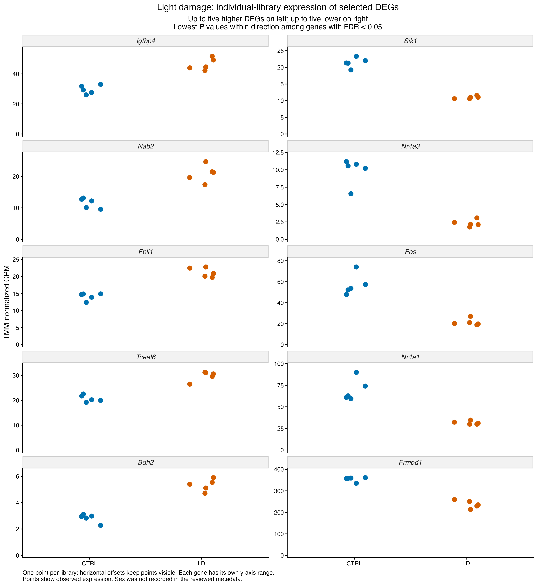
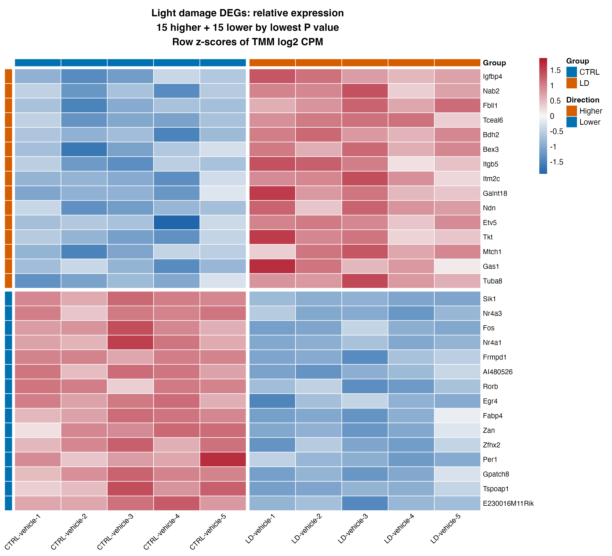
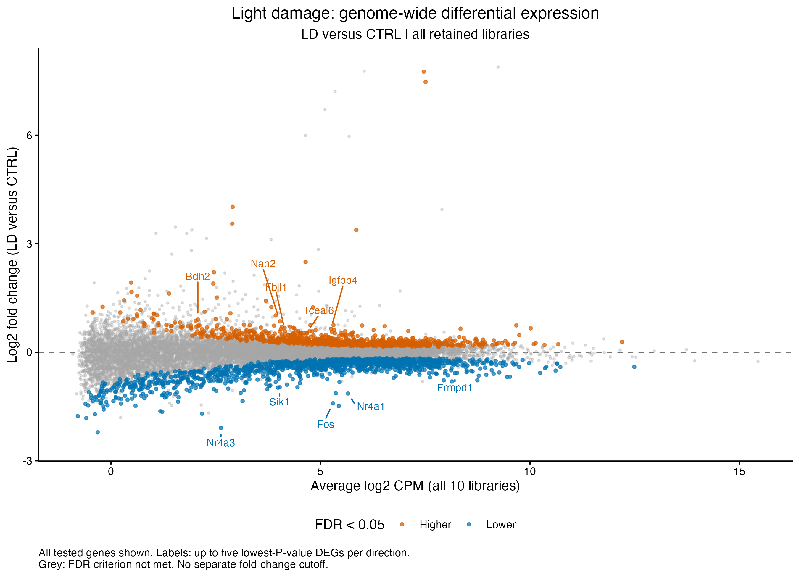
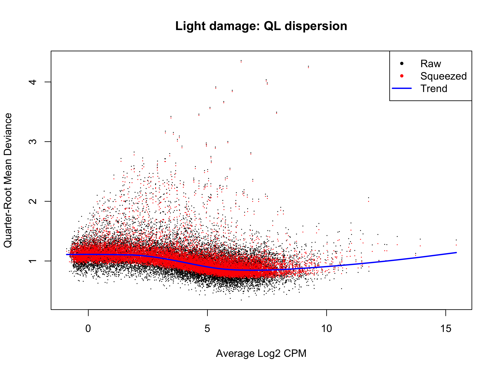

# Light-induced retinal damage (GSE314043): within-study results

Recorded results uploaded 5 November 2026. Source: [GSE314043](https://www.ncbi.nlm.nih.gov/geo/query/acc.cgi?acc=GSE314043).

LD-vehicle versus CTRL-vehicle uses all 10 libraries, five per group, with 16,852 filtered count rows and saved TMM factors. LD-vehicle-5 remains retained with its control-like precheck position documented. Recorded replicate numbers do not establish pairing; no unreported sex category or sample weighting is introduced.

## Model and saved result summary

**Model:** edgeR robust QL; ~ group. The design has 10 samples and 2 estimable terms (8 nominal residual degrees of freedom). In the current edgeR pipeline, gene-specific effective degrees of freedom can differ from this design calculation.

| Comparison | Tested | DEGs | Higher | Lower |
| --- | ---: | ---: | ---: | ---: |
| LD_vs_CTRL | 16,852 | 2,246 | 911 | 1,335 |

The criterion is BH-adjusted FDR < 0.05 within each contrast, without an extra fold-change cutoff. Higher/lower refers to the first named condition relative to its control. Nonsignificant genes remain in complete and ranked tables; failure to meet FDR is not proof of no response. [Saved result tables](../../tables/withinstudy/light_damage/) preserve the numerical outputs.

## Identifiers and rankings

Original Ensembl Geneid values and existing release-116 GRCm39 GTF annotations are preserved, including unnamed/unmatched IDs. Available names are display labels; missing names fall back to original IDs. All tested genes receive signed square-root F rankings, without a new lookup or cross-study harmonization.

## Saved figures

The heatmap shows 15 higher and 15 lower DEGs by P value. Individual-library plots show five per direction in non-log TMM CPM; the heatmap uses row z-scores of normalized log-CPM. These selected-gene displays describe the fitted comparison rather than independently validating group separation.

## Saved state and scope

Final 5 November checkpoint, actual session export and existing fresh-process verification record are present. The saved record reports count/TMM identity, result/rank consistency, plot-value checks and reload success; upload preparation did not rerun it.

[Scripts](../../scripts/withinstudy/light_damage/) retain the original modelling expressions with portable input/output/helper paths. [Execution instructions](running-the-analysis.md) explain local checkpoint requirements and saved-path handling. Binary workspaces and original expression inputs stay local. Original PNGs were copied byte-for-byte; the upload checked saved-table consistency and syntax without executing analysis or loading model workspaces.

Heatmaps describe selected genes relative to each gene's own mean. Diagnostic outlier flags refer to gene variability, not failed samples. DEG totals do not measure disease severity or resemblance to spaceflight, and selected-gene figures are not independent validation. No pathway enrichment or comparison with OSD-758 is included in this stage. See the [shared methods and scope](README.md#methods-and-interpretation).
