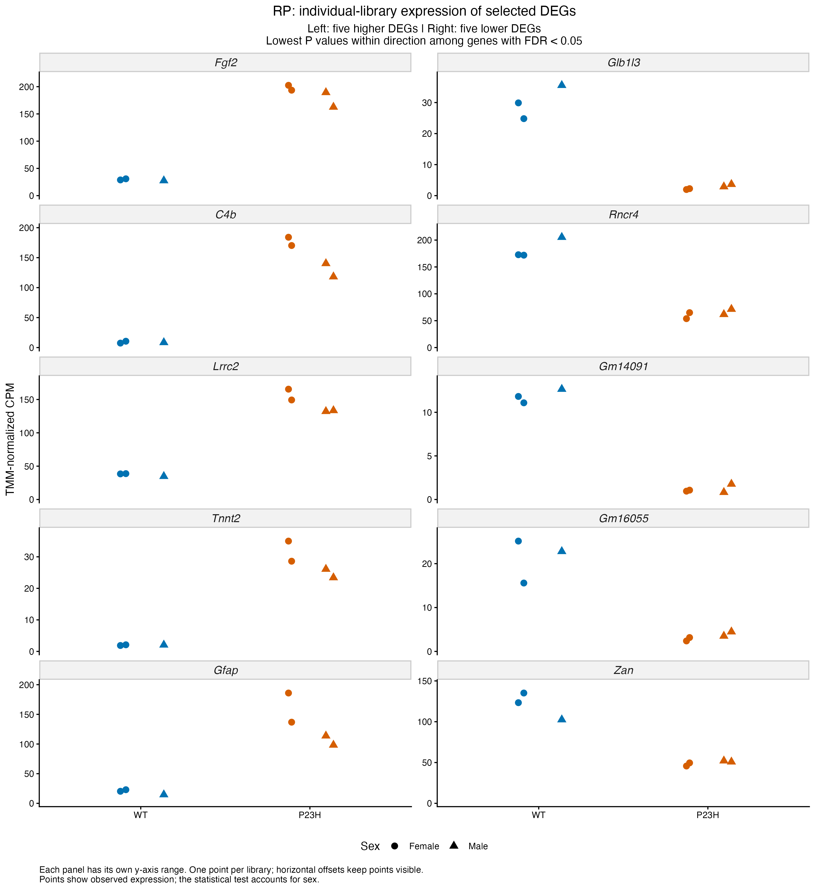
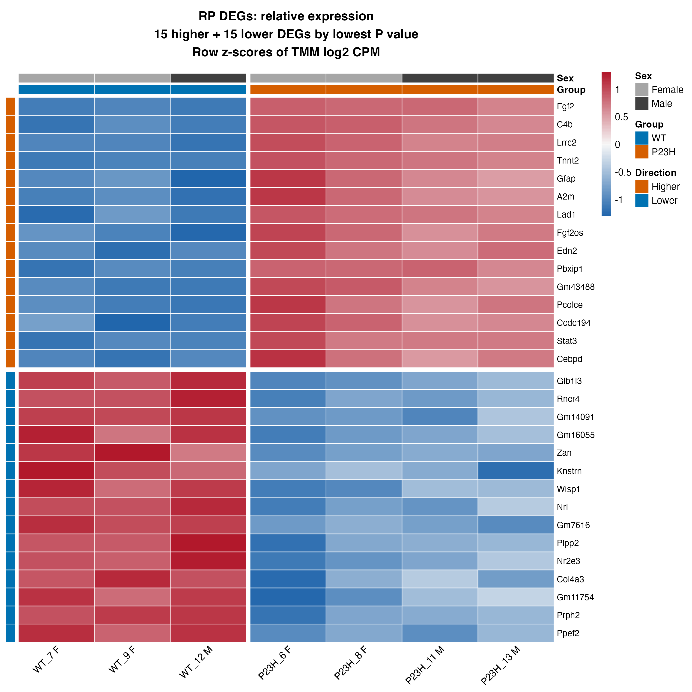
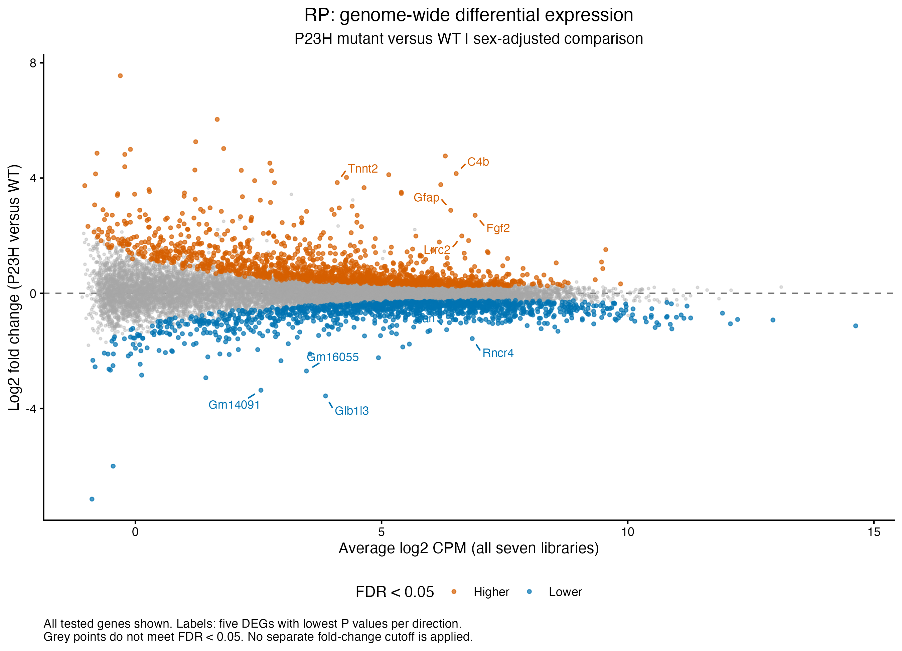
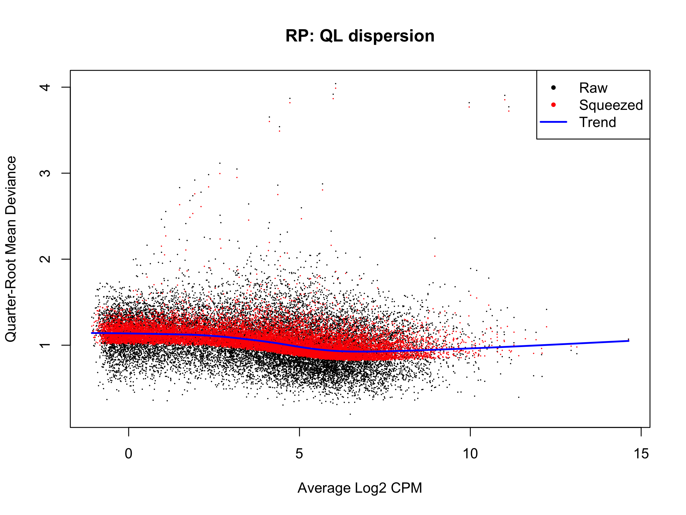

# Retinitis pigmentosa (GSE156533): within-study results

Recorded results uploaded 5 November 2026. Source: [GSE156533](https://www.ncbi.nlm.nih.gov/geo/query/acc.cgi?acc=GSE156533).

P23H mutant versus WT retina at P90 uses all seven libraries: four mutants and three WT. WT has two female/one male libraries; P23H has two of each. The model accounts for sex and reuses the 17,351-row filtered count object with saved TMM factors. No new filtering or normalization is introduced.

## Model and saved result summary

**Model:** edgeR robust QL; ~ sex + group. The design has 7 samples and 3 estimable terms (4 nominal residual degrees of freedom). In the current edgeR pipeline, gene-specific effective degrees of freedom can differ from this design calculation.

| Comparison | Tested | DEGs | Higher | Lower |
| --- | ---: | ---: | ---: | ---: |
| P23H_vs_WT | 17,351 | 2,576 | 1,361 | 1,215 |

The criterion is BH-adjusted FDR < 0.05 within each contrast, without an extra fold-change cutoff. Higher/lower refers to the first named condition relative to its control. Nonsignificant genes remain in complete and ranked tables; failure to meet FDR is not proof of no response. [Saved result tables](../../tables/withinstudy/retinitis_pigmentosa/) preserve the numerical outputs.

## Identifiers and rankings

The original Ensembl gene_id keys and supplied gene_name/annotation fields are preserved. All 17,351 tested genes receive signed square-root F rankings, including nonsignificant genes. The recorded RP F statistics were positive, so no near-zero correction was needed.

## Saved figures

The heatmap shows 15 higher and 15 lower DEGs by lowest P value within direction. Individual-library dot plots show five higher and five lower DEGs in non-log TMM CPM, with sex shapes; their values are observed expression rather than sex-adjusted fitted values.

## Saved state and scope

The result/ranking tables and all four figures are present. The prepared final 5 November checkpoint and final session-information export were not present during this upload. Save/reload scripts are included, but successful final restoration is not claimed.

[Scripts](../../scripts/withinstudy/retinitis_pigmentosa/) retain the original modelling expressions with portable input/output/helper paths. [Execution instructions](running-the-analysis.md) explain local checkpoint requirements and saved-path handling. Binary workspaces and original expression inputs stay local. Original PNGs were copied byte-for-byte; the upload checked saved-table consistency and syntax without executing analysis or loading model workspaces.

Heatmaps describe selected genes relative to each gene's own mean. Diagnostic outlier flags refer to gene variability, not failed samples. DEG totals do not measure disease severity or resemblance to spaceflight, and selected-gene figures are not independent validation. No pathway enrichment or comparison with OSD-758 is included in this stage. See the [shared methods and scope](README.md#methods-and-interpretation).
